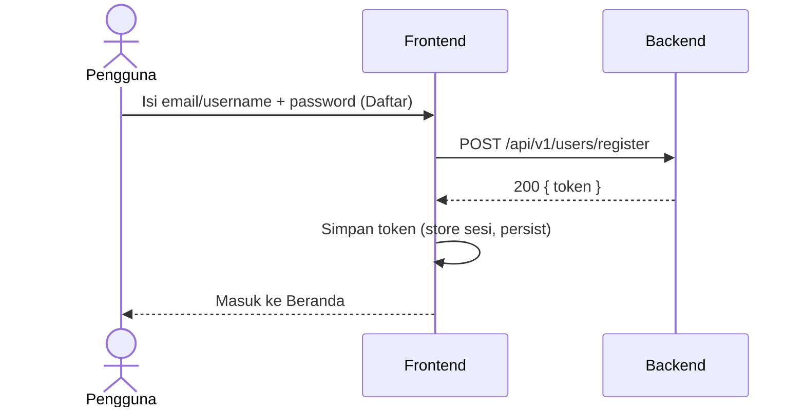
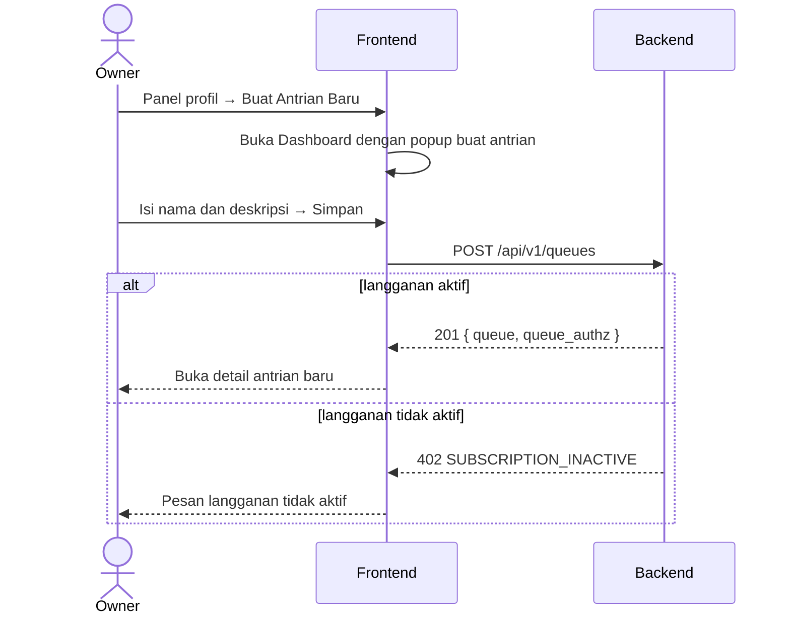
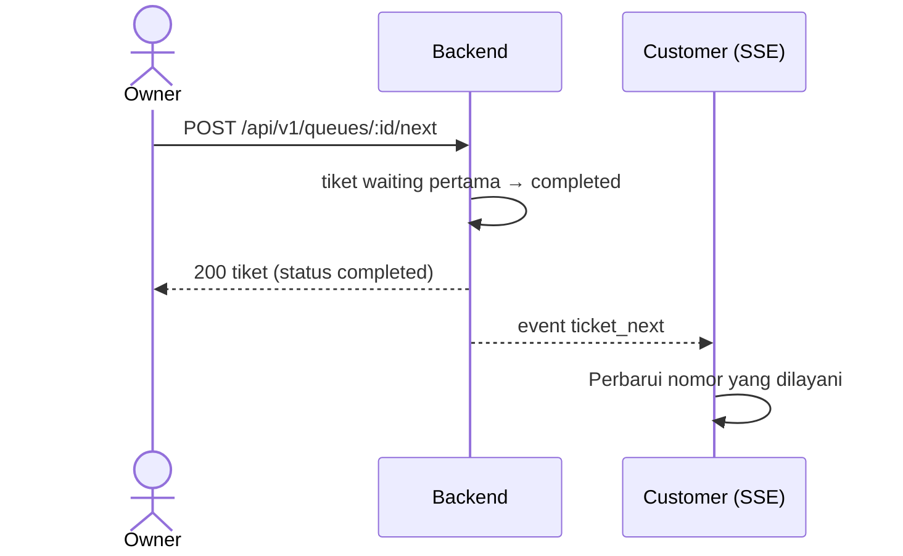
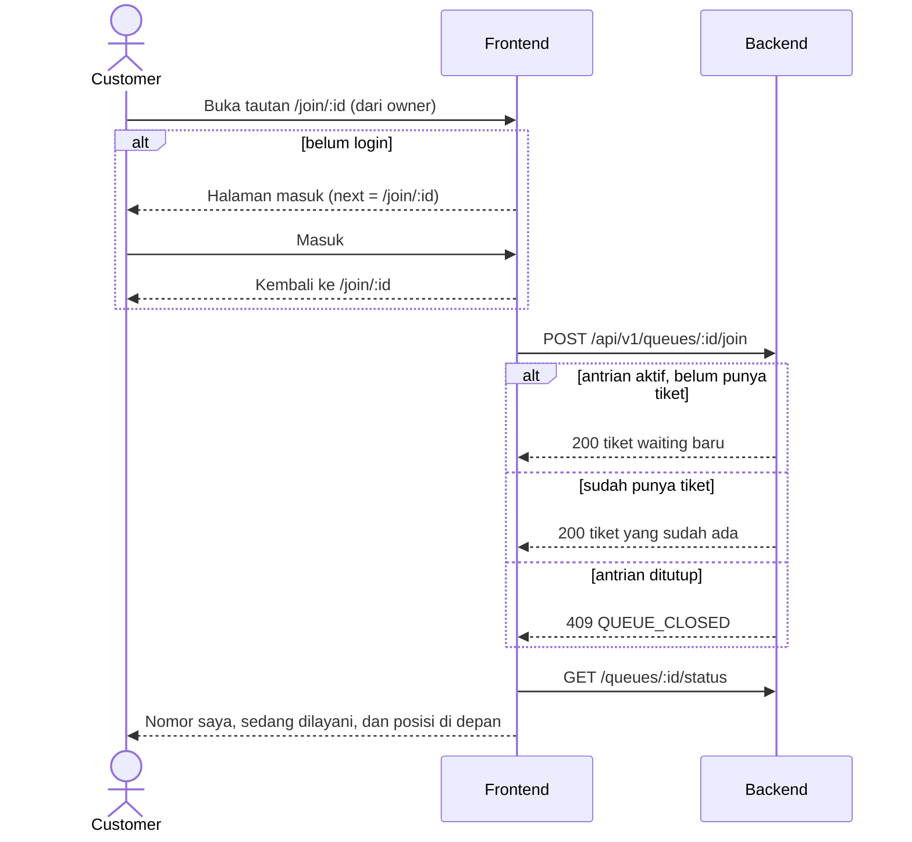

# Flow — Queue Management System

Alur pengguna dan alur sistem, dari sisi owner dan customer. Untuk detail request dan response lihat
[api-contract.md](api-contract.md). Untuk arsitektur lihat [DESIGN.md](DESIGN.md).

## 1. Akun dan sesi

- **Daftar**: email, username, dan password wajib diisi. Email atau username yang sudah dipakai ditolak (409).
- **Masuk**: bisa memakai email atau username. Kalau salah, pesan yang sama untuk kedua kasus.
- **Sesi**: token disimpan di perangkat. Refresh halaman tidak membuat user keluar.
- **Sesi habis**: API membalas 401, sesi dihapus, dan user diarahkan ke halaman masuk. Setelah masuk lagi, user dibawa kembali ke halaman yang tadi dibuka (`next`).
- **Keluar**: lewat panel profil (menu "Keluar").

## 2. Owner: membuat antrian

Syarat: langganan owner aktif. Tanpa langganan, tombol buat antrian tidak bisa dipakai dan API membalas 402.

- Menu "Buat Antrian Baru" ada di panel profil owner. Dari halaman lain, menu itu membuka Dashboard lebih dulu, lalu popup terbuka.
- Antrian baru langsung berstatus `active`.

## 3. Owner: menjalankan antrian (Dashboard)

Dashboard menampilkan antrian aktif pertama milik owner.

1. Papan menampilkan nomor **sebelumnya**, **sedang dilayani**, dan **berikutnya**, serta daftar tiket yang menunggu.
2. Owner menekan **Next**:
   - Backend menandai tiket `waiting` pertama sebagai `completed`.
   - Papan diperbarui: nomor yang baru dipanggil menjadi "sedang dilayani", dan yang sebelumnya menjadi "sebelumnya".
   - Customer di antrian itu menerima event `ticket_next` dan melihat nomornya berubah.
3. Kalau tidak ada tiket yang menunggu, Next membalas 409 `QUEUE_EMPTY` dan tidak ada yang berubah.
4. Setiap event `ticket_joined` atau `ticket_next` memicu pengambilan ulang daftar tiket. Setelah koneksi pulih, daftar juga diambil ulang.

## 4. Owner: detail antrian

Dibuka dari Dashboard (ketuk judul antrian) atau dari Daftar Antrian. Layout dua kolom di layar lebar.

| Bagian | Fungsi |
|---|---|
| Tautan join | Salin tautan `<origin>/join/<id>` untuk dibagikan |
| SKIP / NEXT | NEXT berfungsi. SKIP belum tersedia di backend |
| Append Note | Popup catatan. Belum tersambung ke backend |
| Tampilan customer | Nomor yang sedang dilayani (tanpa posisi sebelum/sesudah) |
| Daftar tiket | Ketuk kartu tampilan customer untuk membuka semua tiket antrian |
| Nama dan deskripsi | Ubah lalu SIMPAN (PUT) |
| Admin | Daftar admin dan tombol tambah admin. Belum tersambung ke backend |
| Otoritas admin | Ubah izin antrian lalu SIMPAN IZIN (PUT `/authz`) |
| Pengaturan antrian | Toggle pengulangan dan QR. Hanya tampilan, belum tersambung |
| Tutup antrian | Konfirmasi dulu, lalu POST `/close` |

Tutup antrian:
1. Owner menekan TUTUP ANTRIAN, lalu mengonfirmasi di popup.
2. Antrian berstatus `closed`. Customer yang belum bergabung tidak bisa join lagi (409 `QUEUE_CLOSED`).
3. Customer yang sudah punya tiket melihat status "antrian ditutup" di halaman mereka. Tiket mereka pindah ke Riwayat.
4. Event `queue_closed` dikirim ke semua yang sedang tersambung.

## 5. Customer: bergabung ke antrian

- Customer harus login sebelum bisa bergabung. Setelah login, halaman join langsung dibuka lagi.
- Scan atau tekan Gabung berulang kali tidak membuat tiket kedua. Layar hanya menampilkan nomor yang sudah ada.
- Gabung di PC bisa lewat tombol "Masuk Ke Antrian" di Beranda. Di HP, lewat tombol QR di tengah navbar.

## 6. Customer: memantau antrian

Sumber data: `GET /queues/:id/status` saat dibuka, lalu SSE untuk pembaruan.

- **Beranda**: kartu untuk setiap tiket yang masih relevan (menunggu di antrian aktif, atau nomornya sedang dilayani).
  Kalau tidak ada, muncul kartu "Anda tidak sedang mengantri".
- **Antrian Saya**: daftar tiket yang sama dengan kriteria Beranda.
- **Riwayat**: tiket di antrian yang sudah ditutup, dan tiket yang sudah dilayani tetapi nomornya sudah lewat.

Event SSE yang diterima customer:

| Event | Yang terjadi di layar |
|---|---|
| `ticket_joined` | Posisi di depan diperbarui |
| `ticket_next` | Nomor yang sedang dilayani dan posisi di depan diperbarui |
| `queue_updated` | Nama antrian diperbarui |
| `queue_closed` | Pesan "antrian ditutup", tiket pindah ke Riwayat |

Kalau koneksi terputus, klien mencoba menyambung lagi dengan jeda yang makin lama (1 detik sampai 30 detik),
lalu mengambil ulang status.

## 7. Tema tampilan

- Tombol matahari/bulan sabit di panel profil mengganti mode terang dan gelap.
- Pilihan disimpan di perangkat dan dipulihkan saat aplikasi dibuka lagi.
- Warna papan antrian dan header tidak berubah, karena memang gelap di kedua mode.

## 8. Yang belum punya alur

Fitur di bawah ini ada di product overview tetapi belum punya endpoint, sehingga alurnya belum bisa dijalankan:
skip tiket, notifikasi ke customer berikutnya, pembatalan oleh customer, hapus customer, counter, admin per counter,
penyisipan posisi, antrian ulang, QR dinamis, riwayat dan ekspor, catatan antrian, login Google, dan pembayaran langganan.
