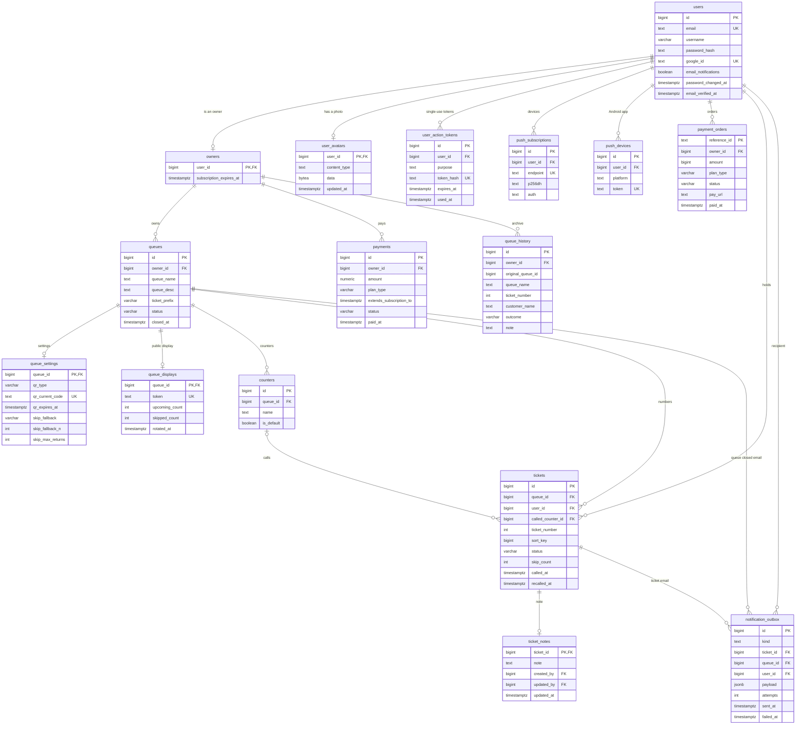

# ERD: QMS Database

Entity-relationship diagram for the PostgreSQL schema of the Queue Management System. The diagram is built from the migration files
in `db/migrations/` (`01a` to `01j` and `02_Indexes.sql`). The original SQL is in the section "Original SQL" below
(its content is identical to the migration files; there is no separate `sql/` folder).

> Note: no separate ERD file was uploaded. The source of truth for this diagram is the SQL below.
> `db/scripts/apply_schema.sql` is the upgrade path for an existing database. A database that was upgraded can differ
> slightly from a new one (see "Known limitations and inconsistencies"); check it against the running database.

## Diagram



## Notes

- `||` means exactly one, `o|` zero or one, `o{` zero or many.
- `queue_history` deliberately has no FK to `queues` or `tickets`, because it works as an archive.
- `payment_orders.owner_id` references `users(id)`, not `owners`, because a prospective owner does not have an `owners` row
  until the payment is confirmed. The migration `08_payment_role.sh` fixes this FK in existing databases.
- `notification_outbox` has two kinds: ticket emails use `ticket_id`, and the `queue-closed` email uses `queue_id`.
- `payment_orders.reference_id` is not referenced by any other table; its link to `payments` exists at the application level.
- `payments` is written by payment-service when an order is paid (`INSERT INTO payments`, role `payment_rw`). The comment in
  `01a_accounts.sql` that mentions the endpoint `POST /api/v1/owners/subscription/extend` (amount 0) is outdated: that endpoint does not exist.
- Important constraints, in addition to the PK, UK, and FK shown in the diagram:
  - `users`: `CHECK (password_hash IS NOT NULL OR google_id IS NOT NULL)`; `email` UNIQUE, `username` is not unique.
  - `queues.ticket_prefix`: `CHECK ~ '^[A-Z0-9]{1,3}$'`, default `'A'`; `queues.status`: `active` or `closed`.
  - `counters`: `UNIQUE (queue_id, name)` (`counters_queue_id_name_key`).
  - `tickets.status`: `waiting`, `currently_served`, `completed`, `cancelled`, `skipped`, `deleted`; `UNIQUE (queue_id, ticket_number)`
    and `UNIQUE (queue_id, sort_key)`.
  - `tickets_serving_has_counter`: `CHECK (status <> 'currently_served' OR called_counter_id IS NOT NULL)`.
  - `queue_settings`: `skip_fallback` (`remove`/`back`/`after_n`, default `back`), `skip_fallback_n >= 1` or NULL, `skip_max_returns >= 1` (default 1),
    `qr_type` (`static`/`dynamic`).
  - `queue_displays`: `upcoming_count` 0-10 (default 5), `skipped_count` 0-10 (default 0), `token` UNIQUE.
  - `user_avatars.data`: at most 153600 bytes; `user_action_tokens.purpose`: `password_reset`, `email_verify`, `email_change` (the last one is not used by the code yet).
  - `notification_outbox.kind`: `joined`, `cancelled`, `removed`, `completed`, `queue-closed`; `UNIQUE (kind, ticket_id)`.
  - `payments.plan_type`/`payment_orders.plan_type`: `monthly`, `yearly`, `one_time`; `payment_orders.status`: `pending`, `paid`, `expired`, `failed`; `payment_orders.amount > 0`.
- Cascading delete (`ON DELETE CASCADE`): `queue_settings`, `queue_displays`, `counters`, `tickets` (from `queues`); `ticket_notes` (from `tickets`);
  `notification_outbox` (from `tickets`, `queues`, `users`); `push_subscriptions`, `push_devices`, `user_avatars`, `user_action_tokens` (from `users`).
  `tickets.called_counter_id` uses `ON DELETE SET NULL`. The other FKs (`owners`, `queues.owner_id`, `tickets.user_id`, `payments`,
  `payment_orders`, `queue_history`, `ticket_notes.created_by/updated_by`) have no delete action (NO ACTION).
- Partial unique indexes that enforce business rules (in `01c_tickets.sql`):
  - `tickets_queue_id_user_id_active_key` on `(queue_id, user_id)` only for `status IN ('waiting', 'currently_served')`: one account, one active ticket per queue.
  - `tickets_one_serving_per_counter` on `(called_counter_id)` only for `status = 'currently_served'`: one counter serves one number.
  - `queue_settings_qr_current_code_key` (join code unique, `WHERE qr_current_code IS NOT NULL`) and `uq_outbox_kind_queue` (`(kind, queue_id) WHERE queue_id IS NOT NULL`).
- Non-unique indexes are in `02_Indexes.sql`: `idx_payments_owner_paid_at`, `idx_queues_owner_created_at`, `idx_tickets_queue_waiting_sort_key` (partial `waiting`),
  `idx_tickets_queue_completed` (partial `completed`), `idx_tickets_user_created_at`, `idx_queue_history_owner_closed`, `idx_push_subscriptions_user`,
  `idx_push_devices_user`, `idx_outbox_pending` (partial, not yet sent and not failed), `user_action_tokens_user_idx`.
- `queue_history` is in the schema but is not used by the backend Go code (it only appears in metrics); the application does not yet write history archive rows.
- There are no `updated_at` triggers: the `updated_at` columns (`queue_settings`, `ticket_notes`, `user_avatars`, `payment_orders`, `push_devices`) must be set by the application.

## Triggers and functions

| Trigger | Table and event | Function | Effect |
|---|---|---|---|
| `tickets_notify_trg` | `tickets`, `AFTER UPDATE OF status, called_at, recalled_at, skip_count` | `tickets_notify()` | `pg_notify('queue_events', ...)` with kind `requeued`, `skipped`, `called`, `recalled` |
| `tickets_email_outbox_trg` | `tickets`, `AFTER INSERT OR UPDATE OF status` | `tickets_email_outbox()` | writes `notification_outbox` (`joined`, `cancelled`, `removed`, `completed`), then `pg_notify('mail_outbox')`; only when `users.email_notifications` is on |
| `queues_email_outbox_trg` | `queues`, `AFTER UPDATE OF status` | `queues_email_outbox()` | for `active` changing to `closed`, writes `queue-closed` to the owner, then `pg_notify('mail_outbox')` |

## Database roles and privileges

Created by the `.sh` scripts in `db/migrations/` (only when the volume is empty; `01h_role_grants.sql` only grants `mail_rw` privileges when the role already exists).

| Role | Script | Privileges |
|---|---|---|
| `qms` (main user) | built into the image | schema owner; used by the backend (`DATABASE_URL`) |
| `notify_ro` | `03_notify_role.sh` | `SELECT` on `tickets`, `queues`, `counters`, `push_subscriptions`, `push_devices`; `DELETE` on `push_subscriptions`, `push_devices` |
| `mail_rw` | `04_mail_role.sh` | `SELECT` on `notification_outbox`; `UPDATE (sent_at, attempts, last_error, next_attempt_at, failed_at)`; `SELECT (id, email, username, email_notifications)` on `users` |
| `auth_rw` | `06_auth_role.sh` | limited columns on `users` (SELECT/INSERT/UPDATE); `SELECT, INSERT` and `UPDATE (used_at)` on `user_action_tokens`; no DELETE |
| `metrics_ro` | `07_metrics_role.sh` | only `pg_monitor` and `CONNECT`; skipped when `METRICS_DB_PASSWORD` is empty |
| `payment_rw` | `08_payment_role.sh` | `owners`: `SELECT`/`INSERT (user_id, subscription_expires_at)`, `UPDATE (subscription_expires_at)`; `payment_orders`: `SELECT, INSERT`, `UPDATE (status, pay_url, paid_at, updated_at)`; `payments`: `INSERT` and the sequence; skipped when `PAYMENT_DB_PASSWORD` is empty |

There is no `05_*` script. The tables `payment_webhook_events` and `payment_session_credits` that older documents may mention do not exist in the schema.
`db/scripts/check_payment_grants.sql` checks the privileges of `payment_rw`.

## Known limitations and inconsistencies

- `tickets_serving_has_counter` is added as `NOT VALID` by `apply_schema.sql`, and then immediately `VALIDATE`d if there are no violations. If there are tickets in `currently_served` without a counter, the script raises a `WARNING` and the constraint stays `NOT VALID` (the script does not stop); fix the data and then run `VALIDATE CONSTRAINT` manually.
- The body of `tickets_notify()` in `apply_schema.sql` is now identical to `01g_triggers.sql` (previously a comment line "Transisi sementara ..." was missing from `apply_schema.sql`).
- `db/scripts/reset_seed_dev.sql` now also `TRUNCATE`s `payment_orders` (previously it did not, so `make seed` failed when order rows existed because of the FK to `users`).
- `queue_settings` columns that the code does not use: see `db/migrations/README.md`.

## Original SQL


### `01a_accounts.sql`

```sql
-- ============================================================================
-- 01a_accounts.sql — Accounts and subscriptions
-- Contents : users, owners, payments
-- Depends on: -
-- Order and rules for all migration files: see db/migrations/README.md.
-- ============================================================================

CREATE TABLE users (
    id                   BIGSERIAL PRIMARY KEY,
    email                TEXT NOT NULL UNIQUE,
    username             VARCHAR NOT NULL,       -- not unique; login accepts email or username
    password_hash        TEXT,                   -- NULL for Google-only accounts
    google_id            TEXT UNIQUE,            -- Google account ID; login/matching uses this, not email (FR 4.17)
    created_at           TIMESTAMPTZ NOT NULL DEFAULT now(),

    -- Ticket email notification switch. Read by the trigger tickets_email_outbox when an event happens.
    email_notifications  BOOLEAN NOT NULL DEFAULT TRUE,
    -- Sessions (JWT) issued before this time are revoked. Set when the password is changed or reset.
    password_changed_at  TIMESTAMPTZ,
    -- Kapan pemilik membuktikan emailnya lewat tautan. NULL = belum terverifikasi.
    -- For older databases, apply_schema.sql adds this column and verifies existing accounts once only.
    email_verified_at    TIMESTAMPTZ,

    -- every user must have at least one login method
    CHECK (password_hash IS NOT NULL OR google_id IS NOT NULL)
);

-- owners is 1:1 with users (shared primary key), so user_id becomes the PK directly. Same pattern as
-- queue_settings, ticket_notes, and user_avatars. This also prevents one user from being registered as an owner twice.
CREATE TABLE owners (
    user_id                  BIGINT PRIMARY KEY REFERENCES users(id),

    -- End of the subscription period. "Active" is NOT stored as a boolean; it is computed when checked
    -- (subscription_expires_at > now()), so no cron job is needed that could be late or fail.
    subscription_expires_at  TIMESTAMPTZ NOT NULL,

    created_at               TIMESTAMPTZ NOT NULL DEFAULT now()
);

-- Record of each subscription payment. owners.subscription_expires_at only stores the CURRENT active date;
-- this table stores the payments that make up that date. Written by payment-service when the order is paid (INSERT INTO payments; the old endpoint POST /api/v1/owners/subscription/extend, amount 0, no longer exists).
CREATE TABLE payments (
    id                       BIGSERIAL PRIMARY KEY,
    owner_id                 BIGINT NOT NULL REFERENCES owners(user_id),

    amount                   NUMERIC(12,2) NOT NULL,
    currency                 VARCHAR NOT NULL DEFAULT 'IDR',
    -- The code currently only writes 'monthly'; 'yearly' and 'one_time' are prepared.
    plan_type                VARCHAR NOT NULL
        CHECK (plan_type IN ('monthly', 'yearly', 'one_time')),

    extends_subscription_to  TIMESTAMPTZ NOT NULL,   -- new end date after this payment

    status                   VARCHAR NOT NULL DEFAULT 'success'
        CHECK (status IN ('success', 'failed', 'refunded')),
    paid_at                  TIMESTAMPTZ NOT NULL DEFAULT now()
);
```

### `01b_queues.sql`

```sql
-- ============================================================================
-- 01b_queues.sql — Queues
-- Contents : queues, queue_settings, counters, queue_displays
-- Depends on: 01a (owners)
-- Order and rules for all migration files: see db/migrations/README.md.
-- ============================================================================

CREATE TABLE queues (
    id             BIGSERIAL PRIMARY KEY,
    owner_id       BIGINT NOT NULL REFERENCES owners(user_id),
    queue_name     TEXT NOT NULL,
    queue_desc     TEXT,
    -- Number prefix the customer sees (e.g. 'A' -> A-001). 1-3 uppercase letters or digits.
    ticket_prefix  VARCHAR(3) NOT NULL DEFAULT 'A' CHECK (ticket_prefix ~ '^[A-Z0-9]{1,3}$'),
    status         VARCHAR NOT NULL DEFAULT 'active'
        CHECK (status IN ('active', 'closed')),
    created_at     TIMESTAMPTZ NOT NULL DEFAULT now(),
    closed_at      TIMESTAMPTZ
);

-- Settings of one queue (1:1 with queues). Columns are grouped by whether the code uses them.
CREATE TABLE queue_settings (
    queue_id               BIGINT PRIMARY KEY REFERENCES queues(id) ON DELETE CASCADE,

    -- [used] QR join mode: static (fixed code, the owner can replace it) or dynamic (the code changes periodically).
    qr_type                VARCHAR NOT NULL DEFAULT 'static'
        CHECK (qr_type IN ('static', 'dynamic')),
    qr_current_code        TEXT,
    -- Active join code (6 characters). Unique across all queues because visitors only type the code, without a queue ID.
    -- Dynamic codes have an expiry in qr_expires_at; static codes do not (NULL).
    qr_expires_at          TIMESTAMPTZ,

    -- [not used] Registration limit per queue. NULL = no limit. Removed from the product on 31 Oct 2026.
    registration_limit     INT,

    -- [not used] Number of upcoming/skipped numbers on the public screen. Replaced by queue_displays
    -- (upcoming_count and skipped_count), stored per queue in its own table.
    display_next_count     INT NOT NULL DEFAULT 3,
    display_skipped_count  INT NOT NULL DEFAULT 3,

    -- [not used] QR code rotation per customer and join limit per calendar day. Removed from the product
    -- on 31 Oct 2026. Do not confuse with skip_fallback below.
    fallback_mode          VARCHAR NOT NULL DEFAULT 'none'
        CHECK (fallback_mode IN ('none', 'once', 'max_n', 'unlimited')),
    fallback_offset        INT,
    fallback_max_attempts  INT,

    -- [used] Skip setting: what happens to a number the owner skips.
    --   remove  : becomes 'skipped' and does not return
    --   back    : returns to 'waiting' at the very back (default for new queues)
    --   after_n : returns to 'waiting' after N waiting tickets (skip_fallback_n)
    -- skip_max_returns = how many times one ticket may be returned; after that it is permanently 'skipped'.
    skip_fallback          VARCHAR NOT NULL DEFAULT 'back'
        CHECK (skip_fallback IN ('remove', 'back', 'after_n')),
    skip_fallback_n        INT CHECK (skip_fallback_n IS NULL OR skip_fallback_n >= 1),
    skip_max_returns       INT NOT NULL DEFAULT 1 CHECK (skip_max_returns >= 1),

    -- [not used] When the sort_key of this queue's tickets was last renormalized. Debug record only.
    last_rebalanced_at     TIMESTAMPTZ,

    updated_at             TIMESTAMPTZ NOT NULL DEFAULT now()
);

-- The active join code must be unique across all queues (see qr_current_code). Replaced old codes are not stored.
CREATE UNIQUE INDEX queue_settings_qr_current_code_key ON queue_settings (qr_current_code) WHERE qr_current_code IS NOT NULL;

-- Calling counter. A counter does not store admins or the ticket it is serving: anyone who logs in as
-- the owner may use any counter, and the ticket records the counter that called it (tickets.called_counter_id).
-- Declared before tickets because tickets references it.
CREATE TABLE counters (
    id          BIGSERIAL PRIMARY KEY,
    queue_id    BIGINT NOT NULL REFERENCES queues(id) ON DELETE CASCADE,
    name        TEXT NOT NULL,
    created_at  TIMESTAMPTZ NOT NULL DEFAULT now(),
    is_default  BOOLEAN NOT NULL DEFAULT FALSE,   -- the default counter cannot be deleted

    CONSTRAINT counters_queue_id_name_key UNIQUE (queue_id, name)
);

-- Public screen of a queue (feature 4.5): one row per queue whose screen is enabled. The random 24-byte `token` is used
-- in the public URL (/display/<token>); stored in plain text because the owner needs to see the URL again. Anyone who
-- holds the token can see that queue's numbers, so notify_ro and mail_rw deliberately have no privileges here.
CREATE TABLE queue_displays (
    queue_id        BIGINT PRIMARY KEY REFERENCES queues(id) ON DELETE CASCADE,
    token           TEXT NOT NULL UNIQUE,
    upcoming_count  INT NOT NULL DEFAULT 5 CHECK (upcoming_count BETWEEN 0 AND 10),   -- next numbers shown
    skipped_count   INT NOT NULL DEFAULT 0 CHECK (skipped_count BETWEEN 0 AND 10),    -- skipped numbers shown
    created_at      TIMESTAMPTZ NOT NULL DEFAULT now(),
    rotated_at      TIMESTAMPTZ                                                       -- last time the token was replaced
);
```

### `01c_tickets.sql`

```sql
-- ============================================================================
-- 01c_tickets.sql — Tickets
-- Contents : tickets, ticket_notes
-- Depends on: 01a (users), 01b (queues, counters)
-- Order and rules for all migration files: see db/migrations/README.md.
-- ============================================================================

CREATE TABLE tickets (
    id                 BIGSERIAL PRIMARY KEY,
    queue_id           BIGINT NOT NULL REFERENCES queues(id) ON DELETE CASCADE,

    -- The number the customer sees; fixed, never changes.
    ticket_number      INT NOT NULL,

    -- Gap-based ordering key (fractional indexing, like Figma/Jira LexoRank): given a large spacing on insert
    -- (multiples of 65536) so that requeue/fallback (FR 4.14) only needs to insert one new value between two
    -- existing sort_keys, WITHOUT rewriting other ticket rows. "Which position" is computed at read time via
    -- ROW_NUMBER() OVER (PARTITION BY queue_id, status ORDER BY sort_key), not stored.
    sort_key           BIGINT NOT NULL,

    -- Customers must log in (revision of FR 4.2; previously anonymous via device_token). Anti-double-join is account-based
    -- (index tickets_queue_id_user_id_active_key below), so it cannot be bypassed by clearing storage or using incognito mode.
    user_id            BIGINT NOT NULL REFERENCES users(id),

    -- waiting          : waiting for its turn
    -- currently_served : being served (source of truth, not derived from completed)
    -- completed        : finished being served
    -- cancelled        : cancelled by the customer
    -- skipped          : skipped by the owner and does not return
    -- deleted          : removed by the owner (not part of the order; the "removed" email is sent through the outbox)
    status             VARCHAR NOT NULL DEFAULT 'waiting'
        CHECK (status IN ('waiting', 'currently_served', 'completed', 'cancelled', 'skipped', 'deleted')),
    skip_count         INT NOT NULL DEFAULT 0,

    -- The counter that called this ticket (set on Next); NULL while not yet called or when that counter was deleted.
    called_counter_id  BIGINT REFERENCES counters(id) ON DELETE SET NULL,
    called_at          TIMESTAMPTZ,
    -- Recall by the owner: allowed once per call (set to NULL each time the ticket is called).
    recalled_at        TIMESTAMPTZ,

    last_notified_at   TIMESTAMPTZ,
    created_at         TIMESTAMPTZ NOT NULL DEFAULT now(),
    completed_at       TIMESTAMPTZ,
    cancelled_at       TIMESTAMPTZ,

    UNIQUE (queue_id, ticket_number),
    -- Safety net: two tickets in the same queue must not have the exact same sort_key
    -- (prevents an insert race condition from silently breaking the order).
    UNIQUE (queue_id, sort_key),

    -- A number being served always has a counter.
    CONSTRAINT tickets_serving_has_counter
        CHECK (status <> 'currently_served' OR called_counter_id IS NOT NULL)
);

-- Anti-double-join: one account has only one active ticket per queue. Only waiting and currently_served
-- are counted; after completion or cancellation, the account may join again and get a new number.
CREATE UNIQUE INDEX tickets_queue_id_user_id_active_key
    ON tickets (queue_id, user_id)
    WHERE status IN ('waiting', 'currently_served');

-- Multi-counter: each counter serves at most one number. Two devices on the same counter cannot
-- serve two numbers at the same time.
CREATE UNIQUE INDEX tickets_one_serving_per_counter
    ON tickets (called_counter_id)
    WHERE status = 'currently_served';

-- The owner's note for one ticket. ticket_id is the PK (not a surrogate id), so writing a second note means
-- UPDATE of this row (editing the note and updated_at/updated_by), not an INSERT of a new row.
CREATE TABLE ticket_notes (
    ticket_id   BIGINT PRIMARY KEY REFERENCES tickets(id) ON DELETE CASCADE,
    note        TEXT NOT NULL,
    created_by  BIGINT REFERENCES users(id),
    created_at  TIMESTAMPTZ NOT NULL DEFAULT now(),
    updated_by  BIGINT REFERENCES users(id),
    updated_at  TIMESTAMPTZ NOT NULL DEFAULT now()
);
```

### `01d_history.sql`

```sql
-- ============================================================================
-- 01d_history.sql — History archive
-- Contents : queue_history
-- Depends on: 01a (owners)
-- Order and rules for all migration files: see db/migrations/README.md.
-- ============================================================================

-- A SEPARATE table, apart from the operational queues/tickets. Deliberately has NO FK to queues(id) or
-- tickets(id):
--   1. Active queues never appear here structurally. Rows exist only if the Go code deliberately writes them
--      (once, when the queue is closed).
--   2. Without a back-reference, live rows (queues/tickets) can be cleaned without affecting the archive. Operational data
--      (must be fast and always consistent, NFR #2) is deliberately separated from historical data.
--   3. No delete trigger. Retention ("keep the 10 most recent per owner") and CSV/Excel export are pure Go logic.
-- Denormalized: one row = one ticket, already including the customer's name and note, so an export only needs a SELECT
-- without a JOIN.

CREATE TABLE queue_history (
    id                 BIGSERIAL PRIMARY KEY,
    owner_id           BIGINT NOT NULL REFERENCES owners(user_id),

    -- Original queue ID saat masih live. Reference/debug only, NOT an FK (the original queue may already be deleted).
    original_queue_id  BIGINT NOT NULL,
    queue_name         TEXT NOT NULL,
    queue_opened_at    TIMESTAMPTZ NOT NULL,
    queue_closed_at    TIMESTAMPTZ NOT NULL,

    ticket_number      INT NOT NULL,
    customer_name      TEXT NOT NULL,
    customer_email     TEXT NOT NULL,
    outcome            VARCHAR NOT NULL,   -- snapshot of tickets.status when archived
    joined_at          TIMESTAMPTZ NOT NULL,
    completed_at       TIMESTAMPTZ,
    cancelled_at       TIMESTAMPTZ,
    skip_count         INT NOT NULL DEFAULT 0,
    note               TEXT,

    archived_at        TIMESTAMPTZ NOT NULL DEFAULT now()
);
```

### `01e_notifications.sql`

```sql
-- ============================================================================
-- 01e_notifications.sql — Notifications
-- Contents : push_subscriptions, notification_outbox
-- Depends on: 01a (users), 01b (queues), 01c (tickets)
-- Order and rules for all migration files: see db/migrations/README.md.
-- ============================================================================

-- Web Push subscriptions per browser (one user can have several devices). Read by notify-service (role notify_ro),
-- which may also delete expired subscriptions.
CREATE TABLE push_subscriptions (
    id          BIGSERIAL PRIMARY KEY,
    user_id     BIGINT NOT NULL REFERENCES users(id) ON DELETE CASCADE,
    endpoint    TEXT NOT NULL UNIQUE,
    p256dh      TEXT NOT NULL,
    auth        TEXT NOT NULL,
    created_at  TIMESTAMPTZ NOT NULL DEFAULT now()
);

-- Email outbox (item 8): to the ticket owner, and to the queue owner when the queue is closed (kind queue-closed). The trigger tickets_email_outbox writes rows here IN THE SAME transaction
-- as the ticket change (or queue status change), so emails are not lost even if mail-service is down. The worker in mail-service
-- (role mail_rw) sends them and retries. Separate from push: push does not depend on email at all.
CREATE TABLE notification_outbox (
    id               BIGSERIAL PRIMARY KEY,
    kind             TEXT NOT NULL CHECK (kind IN ('joined', 'cancelled', 'removed', 'completed', 'queue-closed')),
    ticket_id        BIGINT REFERENCES tickets(id) ON DELETE CASCADE,   -- NULL for queue-closed (no ticket)
    queue_id         BIGINT REFERENCES queues(id) ON DELETE CASCADE,    -- filled only for queue-closed
    user_id          BIGINT NOT NULL REFERENCES users(id) ON DELETE CASCADE,
    payload          JSONB NOT NULL,   -- snapshot: queue_id, queue_name, prefix, number, name (without the owner's note)
    created_at       TIMESTAMPTZ NOT NULL DEFAULT now(),
    next_attempt_at  TIMESTAMPTZ NOT NULL DEFAULT now(),
    sent_at          TIMESTAMPTZ,
    attempts         INT NOT NULL DEFAULT 0,
    last_error       TEXT,
    failed_at        TIMESTAMPTZ,      -- permanent failure (5xx or attempt limit): not retried

    UNIQUE (kind, ticket_id)           -- one email per ticket event (NULLs are treated as distinct, so they do not block queue-closed)
);

-- A queue produces at most one queue-closed email.
CREATE UNIQUE INDEX uq_outbox_kind_queue
    ON notification_outbox (kind, queue_id)
    WHERE queue_id IS NOT NULL;
```

### `01f_profile_security.sql`

```sql
-- ============================================================================
-- 01f_profile_security.sql — Profile and account security
-- Contents : user_avatars, user_action_tokens
-- Depends on: 01a (users)
-- Order and rules for all migration files: see db/migrations/README.md.
-- ============================================================================

-- Profile photo: 512x512 JPEG processed by the server, one per user. Stored in the database so that it is included in backups.
-- The 150 KB limit is enforced by CHECK. notify_ro deliberately has no privileges on this table.
CREATE TABLE user_avatars (
    user_id       BIGINT PRIMARY KEY REFERENCES users(id) ON DELETE CASCADE,
    content_type  TEXT NOT NULL DEFAULT 'image/jpeg',
    data          BYTEA NOT NULL CHECK (octet_length(data) <= 153600),
    updated_at    TIMESTAMPTZ NOT NULL DEFAULT now()
);

-- Single-use tokens for password reset and email verification. What is stored is the token HASH (SHA-256),
-- never the raw token. 'email_change' is prepared for verifying an email change and is not yet used by the code.
-- notify_ro and mail_rw have no privileges on this table.
CREATE TABLE user_action_tokens (
    id          BIGSERIAL PRIMARY KEY,
    user_id     BIGINT NOT NULL REFERENCES users(id) ON DELETE CASCADE,
    purpose     TEXT NOT NULL CHECK (purpose IN ('password_reset', 'email_verify', 'email_change')),
    token_hash  TEXT NOT NULL UNIQUE,
    expires_at  TIMESTAMPTZ NOT NULL,
    used_at     TIMESTAMPTZ,
    created_at  TIMESTAMPTZ NOT NULL DEFAULT now(),
    request_ip  TEXT
);
```

### `01g_triggers.sql`

```sql
-- ============================================================================
-- 01g_triggers.sql — Triggers
-- Contents : functions and triggers tickets_notify, tickets_email_outbox, queues_email_outbox
-- Depends on: 01b (queues, counters), 01c (tickets), 01e (notification_outbox), 01a (users)
-- Order and rules for all migration files: see db/migrations/README.md.
-- ============================================================================

-- Two separate triggers on tickets and one on queues, each with one function. The function body is stored as-is in the catalog
-- of Postgres (including comments inside it); keep its content identical to db/scripts/apply_schema.sql.

-- Signal for notify-service (LISTEN queue_events). It only emits; push delivery happens outside
-- the Next/Skip transaction. NOTIFY is sent on COMMIT, so a rolled-back transaction sends nothing.
-- Events: requeued, skipped, called, recalled. No outbox: a push that happens while notify-service is down is lost.
CREATE FUNCTION tickets_notify() RETURNS trigger AS $$
BEGIN
    -- requeued must be checked first: a skip with fallback also increments skip_count, but the result is a number
    -- returning to waiting, not skipped. The origin status can be completed (Skip demotes the number first),
    -- currently_served (counter deleted), or skipped. reason tells the two sources apart; the counter is carried in the payload
    -- because a deleted counter no longer exists when notify-service reads.
    IF NEW.status = 'waiting' AND OLD.status IN ('currently_served', 'completed', 'skipped') THEN
        PERFORM pg_notify('queue_events', json_build_object(
            'kind', 'requeued', 'queue_id', NEW.queue_id, 'ticket_id', NEW.id,
            'reason', CASE WHEN NEW.skip_count > OLD.skip_count THEN 'skip' ELSE 'counter_closed' END,
            'counter', (SELECT c.name FROM counters c WHERE c.id = OLD.called_counter_id))::text);
    ELSIF NEW.skip_count > OLD.skip_count THEN
        PERFORM pg_notify('queue_events', json_build_object(
            'kind', 'skipped', 'queue_id', NEW.queue_id, 'ticket_id', NEW.id)::text);
    -- Temporary transition: 'completed' is kept during the transition period (see apply_schema.sql).
    ELSIF NEW.status IN ('completed', 'currently_served') AND NEW.called_at IS NOT NULL
       AND NEW.called_at IS DISTINCT FROM OLD.called_at THEN
        PERFORM pg_notify('queue_events', json_build_object(
            'kind', 'called', 'queue_id', NEW.queue_id, 'ticket_id', NEW.id)::text);
    ELSIF NEW.recalled_at IS NOT NULL AND NEW.recalled_at IS DISTINCT FROM OLD.recalled_at THEN
        PERFORM pg_notify('queue_events', json_build_object(
            'kind', 'recalled', 'queue_id', NEW.queue_id, 'ticket_id', NEW.id)::text);
    END IF;
    RETURN NULL;
END;
$$ LANGUAGE plpgsql;

CREATE TRIGGER tickets_notify_trg
    AFTER UPDATE OF status, called_at, recalled_at, skip_count ON tickets
    FOR EACH ROW EXECUTE FUNCTION tickets_notify();

-- Writes notification_outbox for four ticket events: joined (INSERT), cancelled, removed (status deleted),
-- and completed (only from currently_served). Then wakes the mail-service worker via pg_notify('mail_outbox').
CREATE FUNCTION tickets_email_outbox() RETURNS trigger AS $$
DECLARE
    k TEXT;
BEGIN
    IF TG_OP = 'INSERT' THEN
        k := 'joined';
    ELSIF NEW.status = 'cancelled' AND OLD.status IS DISTINCT FROM 'cancelled' THEN
        k := 'cancelled';
    ELSIF NEW.status = 'deleted' AND OLD.status IS DISTINCT FROM 'deleted' THEN
        k := 'removed';
    ELSIF NEW.status = 'completed' AND OLD.status = 'currently_served' THEN
        k := 'completed';
    ELSE
        RETURN NULL;
    END IF;

    -- The user's switch is read at event time: turning the switch off does not cancel old emails,
    -- but later events do not enter the outbox.
    INSERT INTO notification_outbox (kind, ticket_id, user_id, payload)
    SELECT k, NEW.id, u.id, jsonb_build_object(
        'queue_id', q.id, 'queue_name', q.queue_name, 'prefix', q.ticket_prefix,
        'number', NEW.ticket_number, 'name', u.username)
    FROM users u JOIN queues q ON q.id = NEW.queue_id
    WHERE u.id = NEW.user_id AND u.email_notifications
    ON CONFLICT (kind, ticket_id) DO NOTHING;

    IF FOUND THEN
        PERFORM pg_notify('mail_outbox', '');
    END IF;
    RETURN NULL;
END;
$$ LANGUAGE plpgsql;

CREATE TRIGGER tickets_email_outbox_trg
    AFTER INSERT OR UPDATE OF status ON tickets
    FOR EACH ROW EXECUTE FUNCTION tickets_email_outbox();

-- Writes notification_outbox kind queue-closed to the OWNER when the queue is closed (status active becomes closed),
-- then wakes the mail-service worker via pg_notify('mail_outbox').
CREATE FUNCTION queues_email_outbox() RETURNS trigger AS $$
BEGIN
    -- Only closing by the owner (active becomes closed) produces an email.
    IF NOT (OLD.status = 'active' AND NEW.status = 'closed') THEN
        RETURN NULL;
    END IF;

    -- The user's switch is read at event time, the same as ticket emails. No ticket: ticket_id NULL, number 0.
    -- One email per queue at most, thanks to the partial unique index (kind, queue_id).
    INSERT INTO notification_outbox (kind, ticket_id, queue_id, user_id, payload)
    SELECT 'queue-closed', NULL, q.id, u.id, jsonb_build_object(
        'queue_id', q.id, 'queue_name', q.queue_name, 'prefix', q.ticket_prefix,
        'number', 0, 'name', u.username)
    FROM queues q JOIN users u ON u.id = NEW.owner_id
    WHERE q.id = NEW.id AND u.email_notifications
    ON CONFLICT (kind, queue_id) WHERE queue_id IS NOT NULL DO NOTHING;

    IF FOUND THEN
        PERFORM pg_notify('mail_outbox', '');
    END IF;
    RETURN NULL;
END;
$$ LANGUAGE plpgsql;

CREATE TRIGGER queues_email_outbox_trg
    AFTER UPDATE OF status ON queues
    FOR EACH ROW EXECUTE FUNCTION queues_email_outbox();
```

### `01h_role_grants.sql`

```sql
-- ============================================================================
-- 01h_role_grants.sql — Role privileges
-- Contents : conditional GRANT block for role mail_rw
-- Depends on: 01a (users), 01e (notification_outbox)
-- Order and rules for all migration files: see db/migrations/README.md.
-- ============================================================================

-- Per-service roles are created by 03..05_*_role.sh AFTER this file, and those scripts grant their own privileges. This block
-- only applies if the mail_rw role ALREADY exists when this file runs (e.g. a database with leftover roles),
-- so on an empty database init it does nothing. The mail_rw privilege list is the same as 04_mail_role.sh.
DO $$
BEGIN
    IF EXISTS (SELECT 1 FROM pg_roles WHERE rolname = 'mail_rw') THEN
        GRANT USAGE ON SCHEMA public TO mail_rw;
        GRANT SELECT ON notification_outbox TO mail_rw;
        GRANT UPDATE (sent_at, attempts, last_error, next_attempt_at, failed_at) ON notification_outbox TO mail_rw;
        GRANT SELECT (id, email, username, email_notifications) ON users TO mail_rw;
    END IF;
END $$;
```

### `01i_payment_orders.sql`

```sql
-- ============================================================================
-- Contents : payment_orders (BorderPay checkout orders before and after payment)
-- Depends on: 01a (owners)
-- Order and rules for all migration files: see db/migrations/README.md.
-- ============================================================================

CREATE TABLE payment_orders (
    -- Order ID from the main backend. Used as reference_id at BorderPay and in the webhook.
    reference_id   TEXT PRIMARY KEY,
    -- References users, not owners: a prospective owner has no owners row until the payment is paid.
    owner_id       BIGINT NOT NULL REFERENCES users(id),
    -- Amount in rupiah; the webhook must carry the same amount.
    amount         BIGINT NOT NULL CHECK (amount > 0),
    plan_type      VARCHAR NOT NULL CHECK (plan_type IN ('monthly', 'yearly', 'one_time')),
    status         VARCHAR NOT NULL DEFAULT 'pending'
        CHECK (status IN ('pending', 'paid', 'expired', 'failed')),
    -- BorderPay payment page URL (pay_url), filled after BorderPay answers the checkout.
    pay_url        TEXT,
    created_at     TIMESTAMPTZ NOT NULL DEFAULT now(),
    updated_at     TIMESTAMPTZ NOT NULL DEFAULT now(),
    paid_at        TIMESTAMPTZ
);
```

### `01j_push_devices.sql`

```sql
-- ============================================================================
-- 01j_push_devices.sql — Native device push tokens (FCM)
-- Contents : push_devices
-- Depends on: 01a (users)
-- Order and rules for all migration files: see db/migrations/README.md.
-- ============================================================================

-- FCM tokens per Android device (APK app). Separate from push_subscriptions because the shape differs:
-- FCM uses one token, Web Push uses an endpoint and two keys. The same token is moved to the account that last
-- logged in (ON CONFLICT (token) in the backend). Read by notify-service (role notify_ro), which may also delete tokens
-- that are no longer valid (UNREGISTERED from FCM).
CREATE TABLE push_devices (
    id          BIGSERIAL PRIMARY KEY,
    user_id     BIGINT NOT NULL REFERENCES users(id) ON DELETE CASCADE,
    platform    TEXT NOT NULL CHECK (platform IN ('android')),
    token       TEXT NOT NULL UNIQUE,
    created_at  TIMESTAMPTZ NOT NULL DEFAULT now(),
    updated_at  TIMESTAMPTZ NOT NULL DEFAULT now()
);
```

### `02_Indexes.sql`

```sql
-- ============================================================================
-- 02_Indexes.sql — non-unique indexes for lookup queries
-- ============================================================================
-- Run after all 01*.sql files (Docker runs it automatically on an empty database).
--
-- Division of work with 01*.sql (order and rules: see db/migrations/README.md):
--   * 01*.sql contains the PRIMARY KEY and UNIQUE constraints, and the two partial unique indexes that enforce the
--     business rules (tickets_queue_id_user_id_active_key, tickets_one_serving_per_counter) in 01c_tickets.sql.
--   * This file contains ALL other indexes, i.e. those that only speed up queries. The indexes of each table are grouped
--     under one heading, with a note on the queries they serve.
--
-- Safe to run repeatedly (IF NOT EXISTS). Index names must not be changed without a migration: a running database
-- and db/scripts/apply_schema.sql use the same names.
-- ============================================================================


-- ----------------------------------------------------------------------------
-- payments
-- ----------------------------------------------------------------------------

-- Payment history of one owner, ordered by time.
CREATE INDEX IF NOT EXISTS idx_payments_owner_paid_at
    ON payments (owner_id, paid_at);


-- ----------------------------------------------------------------------------
-- queues
-- ----------------------------------------------------------------------------

-- List of queues of one owner, newest first.
CREATE INDEX IF NOT EXISTS idx_queues_owner_created_at
    ON queues (owner_id, created_at DESC);


-- ----------------------------------------------------------------------------
-- tickets
-- ----------------------------------------------------------------------------

-- Waiting tickets, ordered by sort_key. Partial: only status 'waiting', because it is the only
-- status queried repeatedly every second (status page and public screen, NFR #4). Tickets
-- completed/cancelled/skipped stay for history, but are rarely read and should not bloat
-- this frequently used index.
CREATE INDEX IF NOT EXISTS idx_tickets_queue_waiting_sort_key
    ON tickets (queue_id, sort_key) WHERE status = 'waiting';

-- The last number finished being served (LastCompletedNumber, RecentCompletedNumbers). Partial: only
-- 'completed', newest first.
CREATE INDEX IF NOT EXISTS idx_tickets_queue_completed
    ON tickets (queue_id, completed_at DESC, id DESC) WHERE status = 'completed';

-- Ticket history of one customer (ListByUser), newest first.
CREATE INDEX IF NOT EXISTS idx_tickets_user_created_at
    ON tickets (user_id, created_at DESC);


-- ----------------------------------------------------------------------------
-- queue_history
-- ----------------------------------------------------------------------------

-- Used by Go for two things: (1) the history list of one owner, newest first; (2) COUNT(DISTINCT original_queue_id)
-- per owner, to decide whether more than 10 queues have been kept and a DELETE is needed.
CREATE INDEX IF NOT EXISTS idx_queue_history_owner_closed
    ON queue_history (owner_id, queue_closed_at);


-- ----------------------------------------------------------------------------
-- push_subscriptions
-- ----------------------------------------------------------------------------

-- All push subscriptions of one user (send to each device, or remove on logout).
CREATE INDEX IF NOT EXISTS idx_push_subscriptions_user
    ON push_subscriptions (user_id);

-- ----------------------------------------------------------------------------
-- push_devices
-- ----------------------------------------------------------------------------

-- All FCM tokens of one user (send to each Android device).
CREATE INDEX IF NOT EXISTS idx_push_devices_user
    ON push_devices (user_id);


-- ----------------------------------------------------------------------------
-- notification_outbox
-- ----------------------------------------------------------------------------

-- Email send queue: only rows that are not yet sent and not permanently failed, ordered by retry schedule.
-- Partial, so the index stays small even when the table accumulates sent rows.
CREATE INDEX IF NOT EXISTS idx_outbox_pending
    ON notification_outbox (next_attempt_at)
    WHERE sent_at IS NULL AND failed_at IS NULL;


-- ----------------------------------------------------------------------------
-- user_action_tokens
-- ----------------------------------------------------------------------------

-- Latest token of one user per purpose: the per-hour send limit (CountRecentTokens) and cancellation of old tokens.
-- (The name does not start with idx_ because the running database already uses it; do not change it.)
CREATE INDEX IF NOT EXISTS user_action_tokens_user_idx
    ON user_action_tokens (user_id, purpose, created_at DESC);
```