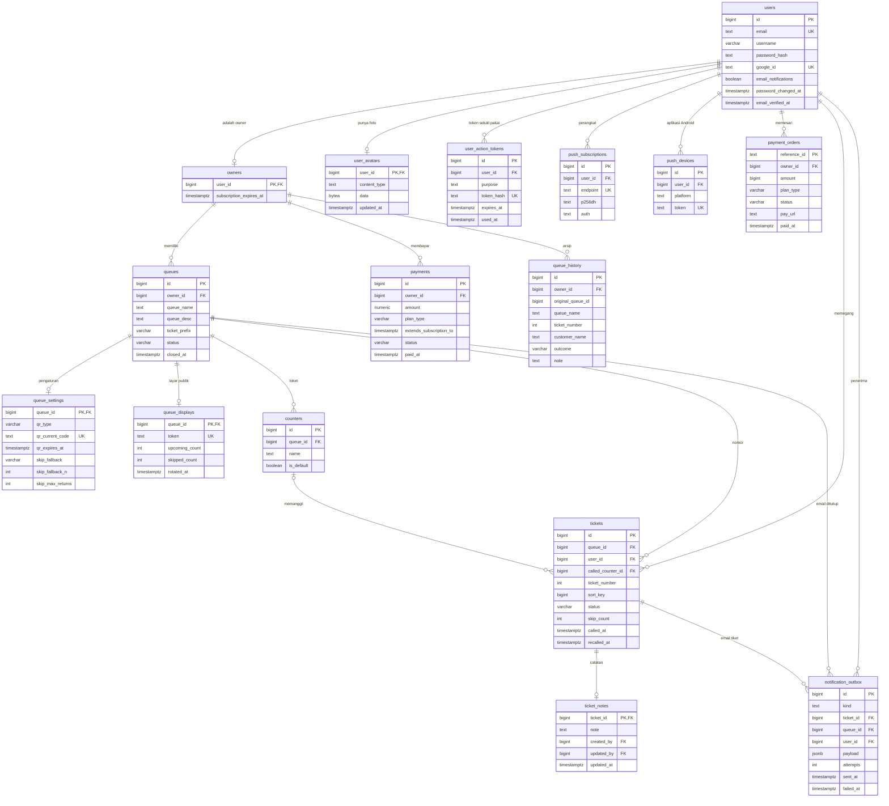

# ERD Database QMS

Diagram entitas-relasi untuk skema PostgreSQL Queue Management System. Diagram dibuat dari berkas migrasi
di `db/migrations/` (`01a` sampai `01j` dan `02_Indexes.sql`). Salinan SQL asli ada di bagian "SQL asli" di bawah
(isinya sama persis dengan berkas migrasi; tidak ada folder `sql/` terpisah).

> Catatan: tidak ada berkas ERD terpisah yang diunggah. Sumber kebenaran diagram ini adalah SQL di bawah.
> `db/scripts/apply_schema.sql` adalah jalur upgrade untuk database yang sudah berjalan. Database hasil upgrade bisa berbeda
> tipis dari database baru (lihat "Keterbatasan dan ketidaksesuaian yang diketahui"); periksa ulang terhadap database yang berjalan.

## Diagram



## Keterangan

- `||` berarti tepat satu, `o|` nol atau satu, `o{` nol atau banyak.
- `queue_history` sengaja tanpa FK ke `queues` atau `tickets`, karena berfungsi sebagai arsip.
- `payment_orders.owner_id` mereferensi `users(id)`, bukan `owners`, karena calon owner belum punya baris `owners`
  sampai pembayaran lunas. Migrasi `08_payment_role.sh` memperbaiki FK ini di database lama.
- `notification_outbox` punya dua jenis: email tiket memakai `ticket_id`, email `queue-closed` memakai `queue_id`.
- `payment_orders.reference_id` tidak direferensikan tabel lain; hubungannya ke `payments` ada di level aplikasi.
- `payments` ditulis oleh payment-service saat pesanan lunas (`INSERT INTO payments`, role `payment_rw`). Komentar di `01a_accounts.sql`
  yang menyebut endpoint `POST /api/v1/owners/subscription/extend` (amount 0) sudah usang: endpoint itu tidak ada.
- Constraint penting, selain PK/UK/FK pada diagram:
  - `users`: `CHECK (password_hash IS NOT NULL OR google_id IS NOT NULL)`; `email` UNIQUE, `username` tidak unik.
  - `queues.ticket_prefix`: `CHECK ~ '^[A-Z0-9]{1,3}$'`, default `'A'`; `queues.status`: `active` atau `closed`.
  - `counters`: `UNIQUE (queue_id, name)` (`counters_queue_id_name_key`).
  - `tickets.status`: `waiting`, `currently_served`, `completed`, `cancelled`, `skipped`, `deleted`; `UNIQUE (queue_id, ticket_number)`
    dan `UNIQUE (queue_id, sort_key)`.
  - `tickets_serving_has_counter`: `CHECK (status <> 'currently_served' OR called_counter_id IS NOT NULL)`.
  - `queue_settings`: `skip_fallback` (`remove`/`back`/`after_n`, default `back`), `skip_fallback_n >= 1` atau NULL, `skip_max_returns >= 1` (default 1),
    `qr_type` (`static`/`dynamic`).
  - `queue_displays`: `upcoming_count` 0-10 (default 5), `skipped_count` 0-10 (default 0), `token` UNIQUE.
  - `user_avatars.data`: maksimal 153600 byte; `user_action_tokens.purpose`: `password_reset`, `email_verify`, `email_change` (yang terakhir belum dipakai kode).
  - `notification_outbox.kind`: `joined`, `cancelled`, `removed`, `completed`, `queue-closed`; `UNIQUE (kind, ticket_id)`.
  - `payments.plan_type`/`payment_orders.plan_type`: `monthly`, `yearly`, `one_time`; `payment_orders.status`: `pending`, `paid`, `expired`, `failed`; `payment_orders.amount > 0`.
- Hapus berantai (`ON DELETE CASCADE`): `queue_settings`, `queue_displays`, `counters`, `tickets` (dari `queues`); `ticket_notes` (dari `tickets`);
  `notification_outbox` (dari `tickets`, `queues`, `users`); `push_subscriptions`, `push_devices`, `user_avatars`, `user_action_tokens` (dari `users`).
  `tickets.called_counter_id` memakai `ON DELETE SET NULL`. FK lain (`owners`, `queues.owner_id`, `tickets.user_id`, `payments`,
  `payment_orders`, `queue_history`, `ticket_notes.created_by/updated_by`) tanpa aksi hapus (NO ACTION).
- Index unik parsial penegak aturan bisnis (di `01c_tickets.sql`):
  - `tickets_queue_id_user_id_active_key` pada `(queue_id, user_id)` hanya untuk `status IN ('waiting', 'currently_served')`: satu akun satu tiket aktif per antrian.
  - `tickets_one_serving_per_counter` pada `(called_counter_id)` hanya untuk `status = 'currently_served'`: satu counter melayani satu nomor.
  - `queue_settings_qr_current_code_key` (kode join unik, `WHERE qr_current_code IS NOT NULL`) dan `uq_outbox_kind_queue` (`(kind, queue_id) WHERE queue_id IS NOT NULL`).
- Index non-unik ada di `02_Indexes.sql`: `idx_payments_owner_paid_at`, `idx_queues_owner_created_at`, `idx_tickets_queue_waiting_sort_key` (parsial `waiting`),
  `idx_tickets_queue_completed` (parsial `completed`), `idx_tickets_user_created_at`, `idx_queue_history_owner_closed`, `idx_push_subscriptions_user`,
  `idx_push_devices_user`, `idx_outbox_pending` (parsial, belum terkirim dan belum gagal), `user_action_tokens_user_idx`.
- `queue_history` ada di skema tetapi tidak dipakai kode Go backend (hanya muncul di metrik); arsip riwayat belum ditulis oleh aplikasi.
- Tidak ada trigger `updated_at`: kolom `updated_at` (`queue_settings`, `ticket_notes`, `user_avatars`, `payment_orders`, `push_devices`) harus diisi oleh aplikasi.

## Trigger dan fungsi

| Trigger | Tabel dan kejadian | Fungsi | Efek |
|---|---|---|---|
| `tickets_notify_trg` | `tickets`, `AFTER UPDATE OF status, called_at, recalled_at, skip_count` | `tickets_notify()` | `pg_notify('queue_events', ...)` dengan kind `requeued`, `skipped`, `called`, `recalled` |
| `tickets_email_outbox_trg` | `tickets`, `AFTER INSERT OR UPDATE OF status` | `tickets_email_outbox()` | menulis `notification_outbox` (`joined`, `cancelled`, `removed`, `completed`), lalu `pg_notify('mail_outbox')`; hanya bila `users.email_notifications` |
| `queues_email_outbox_trg` | `queues`, `AFTER UPDATE OF status` | `queues_email_outbox()` | untuk `active` menjadi `closed`, menulis `queue-closed` ke owner, lalu `pg_notify('mail_outbox')` |

## Role database dan hak

Dibuat oleh skrip `.sh` di `db/migrations/` (hanya saat volume kosong; `01h_role_grants.sql` hanya memberi hak `mail_rw` bila role sudah ada).

| Role | Skrip | Hak |
|---|---|---|
| `qms` (pengguna utama) | bawaan image | pemilik skema; dipakai backend (`DATABASE_URL`) |
| `notify_ro` | `03_notify_role.sh` | `SELECT` pada `tickets`, `queues`, `counters`, `push_subscriptions`, `push_devices`; `DELETE` pada `push_subscriptions`, `push_devices` |
| `mail_rw` | `04_mail_role.sh` | `SELECT` `notification_outbox`; `UPDATE (sent_at, attempts, last_error, next_attempt_at, failed_at)`; `SELECT (id, email, username, email_notifications)` pada `users` |
| `auth_rw` | `06_auth_role.sh` | kolom terbatas pada `users` (SELECT/INSERT/UPDATE); `SELECT, INSERT` dan `UPDATE (used_at)` pada `user_action_tokens`; tanpa DELETE |
| `metrics_ro` | `07_metrics_role.sh` | hanya `pg_monitor` dan `CONNECT`; dilewati bila `METRICS_DB_PASSWORD` kosong |
| `payment_rw` | `08_payment_role.sh` | `owners`: `SELECT`/`INSERT (user_id, subscription_expires_at)`, `UPDATE (subscription_expires_at)`; `payment_orders`: `SELECT, INSERT`, `UPDATE (status, pay_url, paid_at, updated_at)`; `payments`: `INSERT` dan sequence; dilewati bila `PAYMENT_DB_PASSWORD` kosong |

Tidak ada skrip `05_*`; tabel `payment_webhook_events` dan `payment_session_credits` yang mungkin disebut dokumen lama tidak ada di skema.
`db/scripts/check_payment_grants.sql` memeriksa hak `payment_rw`.

## Keterbatasan dan ketidaksesuaian yang diketahui

- `tickets_serving_has_counter` dipasang `NOT VALID` oleh `apply_schema.sql` pada database yang di-upgrade (baris lama tidak dipindai); pada database baru constraint ini valid.
- Badan `tickets_notify()` di `01g_triggers.sql` memuat satu baris komentar ("Transisi sementara ...") yang tidak ada di `apply_schema.sql`;
  logikanya sama, tetapi katalog database baru dan hasil upgrade berbeda satu baris komentar.
- `db/scripts/reset_seed_dev.sql` tidak men-`TRUNCATE` `payment_orders`; baris pesanan dapat tertinggal setelah reset (padahal `users` dikosongkan; FK ke `users` akan membuat `TRUNCATE` gagal bila baris itu ada).
- Kolom `queue_settings` yang tidak dipakai kode: lihat `db/migrations/README.md`.

## SQL asli

### `01a_accounts.sql`

```sql
-- ============================================================================
-- 01a_accounts.sql — Akun dan langganan
-- Isi      : users, owners, payments
-- Bergantung: -
-- Urutan dan aturan seluruh file migrasi: lihat README.md di folder ini.
-- ============================================================================

CREATE TABLE users (
    id                   BIGSERIAL PRIMARY KEY,
    email                TEXT NOT NULL UNIQUE,
    username             VARCHAR NOT NULL,       -- tidak unik; login menerima email atau username
    password_hash        TEXT,                   -- NULL untuk akun Google-only
    google_id            TEXT UNIQUE,            -- ID akun Google; login/matching pakai ini, bukan email (FR 4.17)
    created_at           TIMESTAMPTZ NOT NULL DEFAULT now(),

    -- Sakelar email notifikasi tiket. Dibaca trigger tickets_email_outbox saat kejadian.
    email_notifications  BOOLEAN NOT NULL DEFAULT TRUE,
    -- Sesi (JWT) yang diterbitkan sebelum waktu ini dicabut. Diisi saat password diganti atau direset.
    password_changed_at  TIMESTAMPTZ,
    -- Kapan pemilik membuktikan emailnya lewat tautan. NULL = belum terverifikasi.
    -- Untuk database lama, apply_schema.sql menambahkan kolom ini dan memverifikasi akun yang sudah ada sekali saja.
    email_verified_at    TIMESTAMPTZ,

    -- tiap user minimal punya satu cara login
    CHECK (password_hash IS NOT NULL OR google_id IS NOT NULL)
);

-- owners 1:1 dengan users (shared primary key), jadi user_id langsung menjadi PK. Pola yang sama dengan
-- queue_settings, ticket_notes, dan user_avatars. Ini juga mencegah satu user terdaftar sebagai owner dua kali.
CREATE TABLE owners (
    user_id                  BIGINT PRIMARY KEY REFERENCES users(id),

    -- Akhir masa langganan. "Aktif" TIDAK disimpan sebagai boolean; dihitung saat dicek
    -- (subscription_expires_at > now()), supaya tidak butuh cron yang bisa telat atau gagal.
    subscription_expires_at  TIMESTAMPTZ NOT NULL,

    created_at               TIMESTAMPTZ NOT NULL DEFAULT now()
);

-- Jejak tiap pembayaran langganan. owners.subscription_expires_at hanya menyimpan tanggal aktif SEKARANG;
-- tabel ini menyimpan pembayaran yang membentuk tanggal itu. Ditulis oleh backend (POST /api/v1/owners/subscription/extend, amount 0).
CREATE TABLE payments (
    id                       BIGSERIAL PRIMARY KEY,
    owner_id                 BIGINT NOT NULL REFERENCES owners(user_id),

    amount                   NUMERIC(12,2) NOT NULL,
    currency                 VARCHAR NOT NULL DEFAULT 'IDR',
    -- Kode saat ini hanya menulis 'monthly'; 'yearly' dan 'one_time' disiapkan.
    plan_type                VARCHAR NOT NULL
        CHECK (plan_type IN ('monthly', 'yearly', 'one_time')),

    extends_subscription_to  TIMESTAMPTZ NOT NULL,   -- tanggal berakhir baru setelah pembayaran ini

    status                   VARCHAR NOT NULL DEFAULT 'success'
        CHECK (status IN ('success', 'failed', 'refunded')),
    paid_at                  TIMESTAMPTZ NOT NULL DEFAULT now()
);
```

### `01b_queues.sql`

```sql
-- ============================================================================
-- 01b_queues.sql — Antrian
-- Isi      : queues, queue_settings, counters, queue_displays
-- Bergantung: 01a (owners)
-- Urutan dan aturan seluruh file migrasi: lihat README.md di folder ini.
-- ============================================================================

CREATE TABLE queues (
    id             BIGSERIAL PRIMARY KEY,
    owner_id       BIGINT NOT NULL REFERENCES owners(user_id),
    queue_name     TEXT NOT NULL,
    queue_desc     TEXT,
    -- Prefix nomor tiket yang dilihat customer (mis. 'A' -> A-001). 1-3 huruf besar atau angka.
    ticket_prefix  VARCHAR(3) NOT NULL DEFAULT 'A' CHECK (ticket_prefix ~ '^[A-Z0-9]{1,3}$'),
    status         VARCHAR NOT NULL DEFAULT 'active'
        CHECK (status IN ('active', 'closed')),
    created_at     TIMESTAMPTZ NOT NULL DEFAULT now(),
    closed_at      TIMESTAMPTZ
);

-- Pengaturan satu antrian (1:1 dengan queues). Kolom dikelompokkan menurut apakah kode memakainya.
CREATE TABLE queue_settings (
    queue_id               BIGINT PRIMARY KEY REFERENCES queues(id) ON DELETE CASCADE,

    -- [dipakai] Mode QR join: statis (kode tetap, bisa diganti owner) atau dinamis (kode berubah berkala).
    qr_type                VARCHAR NOT NULL DEFAULT 'static'
        CHECK (qr_type IN ('static', 'dynamic')),
    qr_current_code        TEXT,
    -- Kode join aktif (6 karakter). Unik di seluruh antrian karena pengunjung hanya mengetik kode, tanpa ID antrian.
    -- Kode dinamis punya masa berlaku di qr_expires_at; kode statis tidak (NULL).
    qr_expires_at          TIMESTAMPTZ,

    -- [tidak dipakai] Batas pendaftar per antrian. NULL = tanpa batas. Dihapus dari produk 31 Okt 2026.
    registration_limit     INT,

    -- [tidak dipakai] Jumlah nomor berikutnya/dilewati di layar publik. Digantikan queue_displays
    -- (upcoming_count dan skipped_count), yang disimpan per antrian di tabel tersendiri.
    display_next_count     INT NOT NULL DEFAULT 3,
    display_skipped_count  INT NOT NULL DEFAULT 3,

    -- [tidak dipakai] Rotasi kode QR per customer dan batas join per hari kalender. Dihapus dari produk
    -- 31 Okt 2026. Jangan dikacaukan dengan skip_fallback di bawah.
    fallback_mode          VARCHAR NOT NULL DEFAULT 'none'
        CHECK (fallback_mode IN ('none', 'once', 'max_n', 'unlimited')),
    fallback_offset        INT,
    fallback_max_attempts  INT,

    -- [dipakai] Pengaturan Skip: apa yang terjadi pada nomor yang dilewati owner.
    --   remove  : jadi 'skipped' dan tidak kembali
    --   back    : kembali 'waiting' di posisi paling belakang (bawaan antrian baru)
    --   after_n : kembali 'waiting' setelah N tiket yang sedang menunggu (skip_fallback_n)
    -- skip_max_returns = berapa kali satu tiket boleh dikembalikan; sesudah itu 'skipped' permanen.
    skip_fallback          VARCHAR NOT NULL DEFAULT 'back'
        CHECK (skip_fallback IN ('remove', 'back', 'after_n')),
    skip_fallback_n        INT CHECK (skip_fallback_n IS NULL OR skip_fallback_n >= 1),
    skip_max_returns       INT NOT NULL DEFAULT 1 CHECK (skip_max_returns >= 1),

    -- [tidak dipakai] Kapan sort_key tiket antrian ini terakhir dinormalkan ulang. Murni catatan debug.
    last_rebalanced_at     TIMESTAMPTZ,

    updated_at             TIMESTAMPTZ NOT NULL DEFAULT now()
);

-- Kode join aktif harus unik di seluruh antrian (lihat qr_current_code). Kode lama yang sudah diganti tidak disimpan.
CREATE UNIQUE INDEX queue_settings_qr_current_code_key ON queue_settings (qr_current_code) WHERE qr_current_code IS NOT NULL;

-- Loket pemanggil. Counter tidak menyimpan admin atau tiket yang sedang dilayani: siapa pun yang login sebagai
-- owner boleh memakai counter mana pun, dan tiketlah yang mencatat counter pemanggilnya (tickets.called_counter_id).
-- Dideklarasikan sebelum tickets karena tickets mereferensikannya.
CREATE TABLE counters (
    id          BIGSERIAL PRIMARY KEY,
    queue_id    BIGINT NOT NULL REFERENCES queues(id) ON DELETE CASCADE,
    name        TEXT NOT NULL,
    created_at  TIMESTAMPTZ NOT NULL DEFAULT now(),
    is_default  BOOLEAN NOT NULL DEFAULT FALSE,   -- counter default tidak bisa dihapus

    CONSTRAINT counters_queue_id_name_key UNIQUE (queue_id, name)
);

-- Layar publik antrian (fitur 4.5): satu baris per antrian yang layarnya diaktifkan. `token` acak 24 byte dipakai
-- di URL publik (/display/<token>); disimpan mentah karena owner perlu melihat URL-nya lagi. Siapa pun yang
-- memegang token bisa melihat nomor antrian itu, jadi notify_ro dan mail_rw sengaja tidak diberi hak di sini.
CREATE TABLE queue_displays (
    queue_id        BIGINT PRIMARY KEY REFERENCES queues(id) ON DELETE CASCADE,
    token           TEXT NOT NULL UNIQUE,
    upcoming_count  INT NOT NULL DEFAULT 5 CHECK (upcoming_count BETWEEN 0 AND 10),   -- nomor berikutnya yang ditampilkan
    skipped_count   INT NOT NULL DEFAULT 0 CHECK (skipped_count BETWEEN 0 AND 10),    -- nomor dilewati yang ditampilkan
    created_at      TIMESTAMPTZ NOT NULL DEFAULT now(),
    rotated_at      TIMESTAMPTZ                                                       -- terakhir token diganti
);
```

### `01c_tickets.sql`

```sql
-- ============================================================================
-- 01c_tickets.sql — Tiket
-- Isi      : tickets, ticket_notes
-- Bergantung: 01a (users), 01b (queues, counters)
-- Urutan dan aturan seluruh file migrasi: lihat README.md di folder ini.
-- ============================================================================

CREATE TABLE tickets (
    id                 BIGSERIAL PRIMARY KEY,
    queue_id           BIGINT NOT NULL REFERENCES queues(id) ON DELETE CASCADE,

    -- Nomor yang dilihat customer; tetap, tidak pernah berubah.
    ticket_number      INT NOT NULL,

    -- Kunci urutan gap-based (fractional indexing ala Figma/Jira LexoRank): diberi jarak besar saat insert
    -- (kelipatan 65536) supaya requeue/fallback (FR 4.14) cukup menyisipkan satu nilai baru di antara dua
    -- sort_key yang ada, TANPA menulis ulang baris tiket lain. "Posisi ke berapa" dihitung saat baca lewat
    -- ROW_NUMBER() OVER (PARTITION BY queue_id, status ORDER BY sort_key), bukan disimpan.
    sort_key           BIGINT NOT NULL,

    -- Customer wajib login (revisi FR 4.2; sebelumnya anonim lewat device_token). Anti-double-join berbasis akun
    -- (index tickets_queue_id_user_id_active_key di bawah), jadi tidak bisa dihindari dengan clear storage/incognito.
    user_id            BIGINT NOT NULL REFERENCES users(id),

    -- waiting          : menunggu giliran
    -- currently_served : sedang dilayani (sumber kebenaran, bukan turunan dari completed)
    -- completed        : selesai dilayani
    -- cancelled        : dibatalkan customer
    -- skipped          : dilewati owner dan tidak kembali
    -- deleted          : dihapus owner (tidak ikut urutan; email "removed" dikirim lewat outbox)
    status             VARCHAR NOT NULL DEFAULT 'waiting'
        CHECK (status IN ('waiting', 'currently_served', 'completed', 'cancelled', 'skipped', 'deleted')),
    skip_count         INT NOT NULL DEFAULT 0,

    -- Counter yang memanggil tiket ini (diisi saat Next); NULL selama belum dipanggil atau counter-nya dihapus.
    called_counter_id  BIGINT REFERENCES counters(id) ON DELETE SET NULL,
    called_at          TIMESTAMPTZ,
    -- Panggil ulang oleh owner: boleh sekali per pemanggilan (di-NULL-kan tiap tiket dipanggil).
    recalled_at        TIMESTAMPTZ,

    last_notified_at   TIMESTAMPTZ,
    created_at         TIMESTAMPTZ NOT NULL DEFAULT now(),
    completed_at       TIMESTAMPTZ,
    cancelled_at       TIMESTAMPTZ,

    UNIQUE (queue_id, ticket_number),
    -- Jaring pengaman: dua tiket di antrian yang sama tidak boleh punya sort_key yang persis sama
    -- (mencegah race condition insert merusak urutan secara diam-diam).
    UNIQUE (queue_id, sort_key),

    -- Nomor yang sedang dilayani selalu punya counter.
    CONSTRAINT tickets_serving_has_counter
        CHECK (status <> 'currently_served' OR called_counter_id IS NOT NULL)
);

-- Anti-double-join: satu akun hanya punya satu tiket aktif per antrian. Hanya waiting dan currently_served
-- yang dihitung; setelah selesai atau dibatalkan, akun boleh join lagi dan mendapat nomor baru.
CREATE UNIQUE INDEX tickets_queue_id_user_id_active_key
    ON tickets (queue_id, user_id)
    WHERE status IN ('waiting', 'currently_served');

-- Multi-counter: tiap counter melayani paling banyak satu nomor. Dua perangkat di counter yang sama tidak bisa
-- membuat dua nomor dilayani bersamaan.
CREATE UNIQUE INDEX tickets_one_serving_per_counter
    ON tickets (called_counter_id)
    WHERE status = 'currently_served';

-- Catatan owner untuk satu tiket. ticket_id menjadi PK (bukan id surrogate), jadi menulis catatan kedua berarti
-- UPDATE baris ini (mengedit catatan dan updated_at/updated_by), bukan INSERT baris baru.
CREATE TABLE ticket_notes (
    ticket_id   BIGINT PRIMARY KEY REFERENCES tickets(id) ON DELETE CASCADE,
    note        TEXT NOT NULL,
    created_by  BIGINT REFERENCES users(id),
    created_at  TIMESTAMPTZ NOT NULL DEFAULT now(),
    updated_by  BIGINT REFERENCES users(id),
    updated_at  TIMESTAMPTZ NOT NULL DEFAULT now()
);
```

### `01d_history.sql`

```sql
-- ============================================================================
-- 01d_history.sql — Arsip riwayat
-- Isi      : queue_history
-- Bergantung: 01a (owners)
-- Urutan dan aturan seluruh file migrasi: lihat README.md di folder ini.
-- ============================================================================

-- Tabel KHUSUS, terpisah dari queues/tickets yang operasional. Sengaja TIDAK punya FK ke queues(id) atau
-- tickets(id):
--   1. Antrian aktif tidak pernah muncul di sini secara struktural. Baris hanya ada bila Go sengaja menulisnya
--      (sekali, saat antrian ditutup).
--   2. Tanpa FK balik, baris live (queues/tickets) bebas dibersihkan tanpa memengaruhi arsip. Data operasional
--      (harus cepat dan selalu konsisten, NFR #2) sengaja dipisah dari data historis.
--   3. Tidak ada trigger penghapusan. Retensi "simpan 10 terbaru per owner" dan ekspor CSV/Excel murni logika Go.
-- Denormalisasi: satu baris = satu tiket, sudah termasuk nama customer dan catatan, supaya ekspor cukup SELECT
-- tanpa JOIN.

CREATE TABLE queue_history (
    id                 BIGSERIAL PRIMARY KEY,
    owner_id           BIGINT NOT NULL REFERENCES owners(user_id),

    -- ID antrian asli saat masih live. Hanya referensi/debug, BUKAN FK (antrian aslinya boleh sudah dihapus).
    original_queue_id  BIGINT NOT NULL,
    queue_name         TEXT NOT NULL,
    queue_opened_at    TIMESTAMPTZ NOT NULL,
    queue_closed_at    TIMESTAMPTZ NOT NULL,

    ticket_number      INT NOT NULL,
    customer_name      TEXT NOT NULL,
    customer_email     TEXT NOT NULL,
    outcome            VARCHAR NOT NULL,   -- snapshot tickets.status saat diarsipkan
    joined_at          TIMESTAMPTZ NOT NULL,
    completed_at       TIMESTAMPTZ,
    cancelled_at       TIMESTAMPTZ,
    skip_count         INT NOT NULL DEFAULT 0,
    note               TEXT,

    archived_at        TIMESTAMPTZ NOT NULL DEFAULT now()
);
```

### `01e_notifications.sql`

```sql
-- ============================================================================
-- 01e_notifications.sql — Notifikasi
-- Isi      : push_subscriptions, notification_outbox
-- Bergantung: 01a (users), 01b (queues), 01c (tickets)
-- Urutan dan aturan seluruh file migrasi: lihat README.md di folder ini.
-- ============================================================================

-- Langganan Web Push per browser (satu user bisa punya banyak perangkat). Dibaca notify-service (role notify_ro),
-- yang juga boleh menghapus langganan yang sudah kedaluwarsa.
CREATE TABLE push_subscriptions (
    id          BIGSERIAL PRIMARY KEY,
    user_id     BIGINT NOT NULL REFERENCES users(id) ON DELETE CASCADE,
    endpoint    TEXT NOT NULL UNIQUE,
    p256dh      TEXT NOT NULL,
    auth        TEXT NOT NULL,
    created_at  TIMESTAMPTZ NOT NULL DEFAULT now()
);

-- Outbox email (item 8): ke pemilik tiket, dan ke owner saat antriannya ditutup (kind queue-closed). Trigger tickets_email_outbox menulis baris di sini DALAM transaksi
-- yang sama dengan perubahan tiket (atau status antrian), jadi email tidak hilang walau mail-service mati. Worker di mail-service
-- (role mail_rw) mengirimnya dan mencoba ulang. Terpisah dari push: push tidak bergantung pada email sama sekali.
CREATE TABLE notification_outbox (
    id               BIGSERIAL PRIMARY KEY,
    kind             TEXT NOT NULL CHECK (kind IN ('joined', 'cancelled', 'removed', 'completed', 'queue-closed')),
    ticket_id        BIGINT REFERENCES tickets(id) ON DELETE CASCADE,   -- NULL untuk queue-closed (tidak ada tiket)
    queue_id         BIGINT REFERENCES queues(id) ON DELETE CASCADE,    -- diisi hanya untuk queue-closed
    user_id          BIGINT NOT NULL REFERENCES users(id) ON DELETE CASCADE,
    payload          JSONB NOT NULL,   -- snapshot: queue_id, queue_name, prefix, number, name (tanpa catatan owner)
    created_at       TIMESTAMPTZ NOT NULL DEFAULT now(),
    next_attempt_at  TIMESTAMPTZ NOT NULL DEFAULT now(),
    sent_at          TIMESTAMPTZ,
    attempts         INT NOT NULL DEFAULT 0,
    last_error       TEXT,
    failed_at        TIMESTAMPTZ,      -- gagal permanen (5xx atau batas percobaan): tidak dicoba lagi

    UNIQUE (kind, ticket_id)           -- satu email per kejadian tiket (NULL dianggap berbeda, jadi tidak menghalangi queue-closed)
);

-- Satu antrian paling banyak menghasilkan satu email queue-closed.
CREATE UNIQUE INDEX uq_outbox_kind_queue
    ON notification_outbox (kind, queue_id)
    WHERE queue_id IS NOT NULL;
```

### `01f_profile_security.sql`

```sql
-- ============================================================================
-- 01f_profile_security.sql — Profil dan keamanan akun
-- Isi      : user_avatars, user_action_tokens
-- Bergantung: 01a (users)
-- Urutan dan aturan seluruh file migrasi: lihat README.md di folder ini.
-- ============================================================================

-- Foto profil: JPEG 512x512 hasil olahan server, satu per user. Disimpan di database supaya ikut backup.
-- Batas 150 KB dijaga CHECK. notify_ro sengaja tidak diberi hak apa pun di tabel ini.
CREATE TABLE user_avatars (
    user_id       BIGINT PRIMARY KEY REFERENCES users(id) ON DELETE CASCADE,
    content_type  TEXT NOT NULL DEFAULT 'image/jpeg',
    data          BYTEA NOT NULL CHECK (octet_length(data) <= 153600),
    updated_at    TIMESTAMPTZ NOT NULL DEFAULT now()
);

-- Token sekali pakai untuk reset password dan verifikasi email. Yang disimpan adalah HASH token (SHA-256),
-- tidak pernah token mentahnya. 'email_change' disiapkan untuk verifikasi ganti email dan belum dipakai kode.
-- notify_ro dan mail_rw tidak diberi hak apa pun di tabel ini.
CREATE TABLE user_action_tokens (
    id          BIGSERIAL PRIMARY KEY,
    user_id     BIGINT NOT NULL REFERENCES users(id) ON DELETE CASCADE,
    purpose     TEXT NOT NULL CHECK (purpose IN ('password_reset', 'email_verify', 'email_change')),
    token_hash  TEXT NOT NULL UNIQUE,
    expires_at  TIMESTAMPTZ NOT NULL,
    used_at     TIMESTAMPTZ,
    created_at  TIMESTAMPTZ NOT NULL DEFAULT now(),
    request_ip  TEXT
);
```

### `01g_triggers.sql`

```sql
-- ============================================================================
-- 01g_triggers.sql — Trigger
-- Isi      : fungsi dan trigger tickets_notify, tickets_email_outbox, queues_email_outbox
-- Bergantung: 01b (queues, counters), 01c (tickets), 01e (notification_outbox), 01a (users)
-- Urutan dan aturan seluruh file migrasi: lihat README.md di folder ini.
-- ============================================================================

-- Dua trigger terpisah pada tickets dan satu pada queues, masing-masing satu fungsi. Isi fungsi tersimpan apa adanya di katalog
-- Postgres (termasuk komentar di dalamnya); jaga isinya sama dengan db/scripts/apply_schema.sql.

-- Sinyal untuk notify-service (LISTEN queue_events). Hanya memancarkan; pengiriman push terjadi di luar
-- transaksi Next/Skip. NOTIFY dikirim saat COMMIT, jadi transaksi yang dibatalkan tidak mengirim apa pun.
-- Event: requeued, skipped, called, recalled. Tanpa outbox: push yang terjadi saat notify-service mati hilang.
CREATE FUNCTION tickets_notify() RETURNS trigger AS $$
BEGIN
    -- requeued harus dicek paling awal: skip dengan fallback juga menaikkan skip_count, tetapi hasilnya nomor
    -- kembali menunggu, bukan skipped. Asal status bisa completed (Skip menurunkan nomor lebih dulu),
    -- currently_served (counter dihapus), atau skipped. reason membedakan dua sumber; counter dibawa di payload
    -- karena counter yang dihapus sudah tidak ada saat notify-service membaca.
    IF NEW.status = 'waiting' AND OLD.status IN ('currently_served', 'completed', 'skipped') THEN
        PERFORM pg_notify('queue_events', json_build_object(
            'kind', 'requeued', 'queue_id', NEW.queue_id, 'ticket_id', NEW.id,
            'reason', CASE WHEN NEW.skip_count > OLD.skip_count THEN 'skip' ELSE 'counter_closed' END,
            'counter', (SELECT c.name FROM counters c WHERE c.id = OLD.called_counter_id))::text);
    ELSIF NEW.skip_count > OLD.skip_count THEN
        PERFORM pg_notify('queue_events', json_build_object(
            'kind', 'skipped', 'queue_id', NEW.queue_id, 'ticket_id', NEW.id)::text);
    -- Transisi sementara: 'completed' dibiarkan selama masa transisi (lihat apply_schema.sql).
    ELSIF NEW.status IN ('completed', 'currently_served') AND NEW.called_at IS NOT NULL
       AND NEW.called_at IS DISTINCT FROM OLD.called_at THEN
        PERFORM pg_notify('queue_events', json_build_object(
            'kind', 'called', 'queue_id', NEW.queue_id, 'ticket_id', NEW.id)::text);
    ELSIF NEW.recalled_at IS NOT NULL AND NEW.recalled_at IS DISTINCT FROM OLD.recalled_at THEN
        PERFORM pg_notify('queue_events', json_build_object(
            'kind', 'recalled', 'queue_id', NEW.queue_id, 'ticket_id', NEW.id)::text);
    END IF;
    RETURN NULL;
END;
$$ LANGUAGE plpgsql;

CREATE TRIGGER tickets_notify_trg
    AFTER UPDATE OF status, called_at, recalled_at, skip_count ON tickets
    FOR EACH ROW EXECUTE FUNCTION tickets_notify();

-- Menulis notification_outbox untuk empat kejadian tiket: joined (INSERT), cancelled, removed (status deleted),
-- dan completed (hanya dari currently_served). Lalu membangunkan worker mail-service lewat pg_notify('mail_outbox').
CREATE FUNCTION tickets_email_outbox() RETURNS trigger AS $$
DECLARE
    k TEXT;
BEGIN
    IF TG_OP = 'INSERT' THEN
        k := 'joined';
    ELSIF NEW.status = 'cancelled' AND OLD.status IS DISTINCT FROM 'cancelled' THEN
        k := 'cancelled';
    ELSIF NEW.status = 'deleted' AND OLD.status IS DISTINCT FROM 'deleted' THEN
        k := 'removed';
    ELSIF NEW.status = 'completed' AND OLD.status = 'currently_served' THEN
        k := 'completed';
    ELSE
        RETURN NULL;
    END IF;

    -- Sakelar pengguna dibaca saat kejadian: mematikan sakelar tidak membatalkan email lama,
    -- tetapi kejadian sesudahnya tidak masuk outbox.
    INSERT INTO notification_outbox (kind, ticket_id, user_id, payload)
    SELECT k, NEW.id, u.id, jsonb_build_object(
        'queue_id', q.id, 'queue_name', q.queue_name, 'prefix', q.ticket_prefix,
        'number', NEW.ticket_number, 'name', u.username)
    FROM users u JOIN queues q ON q.id = NEW.queue_id
    WHERE u.id = NEW.user_id AND u.email_notifications
    ON CONFLICT (kind, ticket_id) DO NOTHING;

    IF FOUND THEN
        PERFORM pg_notify('mail_outbox', '');
    END IF;
    RETURN NULL;
END;
$$ LANGUAGE plpgsql;

CREATE TRIGGER tickets_email_outbox_trg
    AFTER INSERT OR UPDATE OF status ON tickets
    FOR EACH ROW EXECUTE FUNCTION tickets_email_outbox();

-- Menulis notification_outbox kind queue-closed ke OWNER saat antrian ditutup (status active menjadi closed),
-- lalu membangunkan worker mail-service lewat pg_notify('mail_outbox').
CREATE FUNCTION queues_email_outbox() RETURNS trigger AS $$
BEGIN
    -- Hanya penutupan oleh owner (active menjadi closed) yang menghasilkan email.
    IF NOT (OLD.status = 'active' AND NEW.status = 'closed') THEN
        RETURN NULL;
    END IF;

    -- Sakelar pengguna dibaca saat kejadian, sama seperti email tiket. Tanpa tiket: ticket_id NULL, number 0.
    -- Satu antrian paling banyak satu email berkat indeks unik parsial (kind, queue_id).
    INSERT INTO notification_outbox (kind, ticket_id, queue_id, user_id, payload)
    SELECT 'queue-closed', NULL, q.id, u.id, jsonb_build_object(
        'queue_id', q.id, 'queue_name', q.queue_name, 'prefix', q.ticket_prefix,
        'number', 0, 'name', u.username)
    FROM queues q JOIN users u ON u.id = NEW.owner_id
    WHERE q.id = NEW.id AND u.email_notifications
    ON CONFLICT (kind, queue_id) WHERE queue_id IS NOT NULL DO NOTHING;

    IF FOUND THEN
        PERFORM pg_notify('mail_outbox', '');
    END IF;
    RETURN NULL;
END;
$$ LANGUAGE plpgsql;

CREATE TRIGGER queues_email_outbox_trg
    AFTER UPDATE OF status ON queues
    FOR EACH ROW EXECUTE FUNCTION queues_email_outbox();
```

### `01h_role_grants.sql`

```sql
-- ============================================================================
-- 01h_role_grants.sql — Hak role
-- Isi      : blok GRANT bersyarat untuk role mail_rw
-- Bergantung: 01a (users), 01e (notification_outbox)
-- Urutan dan aturan seluruh file migrasi: lihat README.md di folder ini.
-- ============================================================================

-- Role per service dibuat oleh 03..05_*_role.sh SETELAH file ini, dan skrip itu memberi hak sendiri. Blok ini
-- hanya berlaku bila role mail_rw SUDAH ada saat file ini dijalankan (mis. database dengan role yang tersisa),
-- jadi pada init database kosong ia tidak melakukan apa-apa. Daftar hak mail_rw sama dengan 04_mail_role.sh.
DO $$
BEGIN
    IF EXISTS (SELECT 1 FROM pg_roles WHERE rolname = 'mail_rw') THEN
        GRANT USAGE ON SCHEMA public TO mail_rw;
        GRANT SELECT ON notification_outbox TO mail_rw;
        GRANT UPDATE (sent_at, attempts, last_error, next_attempt_at, failed_at) ON notification_outbox TO mail_rw;
        GRANT SELECT (id, email, username, email_notifications) ON users TO mail_rw;
    END IF;
END $$;
```

### `01i_payment_orders.sql`

```sql
-- ============================================================================
-- Isi      : payment_orders (pesanan checkout BorderPay sebelum dan sesudah dibayar)
-- Bergantung: 01a (owners)
-- Urutan dan aturan seluruh file migrasi: lihat README.md di folder ini.
-- ============================================================================

CREATE TABLE payment_orders (
    -- ID pesanan dari backend utama. Dipakai sebagai reference_id di BorderPay dan di webhook.
    reference_id   TEXT PRIMARY KEY,
    -- Mereferensi users, bukan owners: calon owner belum punya baris owners sampai pembayaran lunas.
    owner_id       BIGINT NOT NULL REFERENCES users(id),
    -- Nominal dalam rupiah; webhook harus membawa nominal yang sama.
    amount         BIGINT NOT NULL CHECK (amount > 0),
    plan_type      VARCHAR NOT NULL CHECK (plan_type IN ('monthly', 'yearly', 'one_time')),
    status         VARCHAR NOT NULL DEFAULT 'pending'
        CHECK (status IN ('pending', 'paid', 'expired', 'failed')),
    -- URL halaman pembayaran BorderPay (pay_url), diisi setelah BorderPay membalas checkout.
    pay_url        TEXT,
    created_at     TIMESTAMPTZ NOT NULL DEFAULT now(),
    updated_at     TIMESTAMPTZ NOT NULL DEFAULT now(),
    paid_at        TIMESTAMPTZ
);
```

### `01j_push_devices.sql`

```sql
-- ============================================================================
-- 01j_push_devices.sql — Token push perangkat native (FCM)
-- Isi      : push_devices
-- Bergantung: 01a (users)
-- Urutan dan aturan seluruh file migrasi: lihat README.md di folder ini.
-- ============================================================================

-- Token FCM per perangkat Android (aplikasi APK). Terpisah dari push_subscriptions karena bentuknya berbeda:
-- FCM memakai satu token, Web Push memakai endpoint dan dua kunci. Token yang sama dipindah ke akun yang terakhir
-- login (ON CONFLICT (token) di backend). Dibaca notify-service (role notify_ro), yang juga boleh menghapus token
-- yang sudah tidak berlaku (UNREGISTERED dari FCM).
CREATE TABLE push_devices (
    id          BIGSERIAL PRIMARY KEY,
    user_id     BIGINT NOT NULL REFERENCES users(id) ON DELETE CASCADE,
    platform    TEXT NOT NULL CHECK (platform IN ('android')),
    token       TEXT NOT NULL UNIQUE,
    created_at  TIMESTAMPTZ NOT NULL DEFAULT now(),
    updated_at  TIMESTAMPTZ NOT NULL DEFAULT now()
);
```

### `02_Indexes.sql`

```sql
-- ============================================================================
-- 02_Indexes.sql — index non-unik untuk query lookup
-- ============================================================================
-- Dijalankan setelah semua 01*.sql (Docker menjalankannya otomatis di database kosong).
--
-- Pembagian tugas dengan 01*.sql (urutan dan aturan: lihat README.md di folder ini):
--   * 01*.sql memuat constraint PRIMARY KEY dan UNIQUE, serta dua index unik parsial yang menegakkan aturan
--     bisnis (tickets_queue_id_user_id_active_key, tickets_one_serving_per_counter) di 01c_tickets.sql.
--   * File ini memuat SEMUA index lain, yaitu yang hanya mempercepat query. Index tiap tabel dikelompokkan
--     di bawah satu judul, dengan keterangan query yang dilayaninya.
--
-- Aman dijalankan berulang (IF NOT EXISTS). Nama index tidak boleh diganti tanpa migrasi: database yang
-- sudah berjalan dan db/scripts/apply_schema.sql memakai nama yang sama.
-- ============================================================================


-- ----------------------------------------------------------------------------
-- payments
-- ----------------------------------------------------------------------------

-- Riwayat pembayaran satu owner, berurutan menurut waktu.
CREATE INDEX IF NOT EXISTS idx_payments_owner_paid_at
    ON payments (owner_id, paid_at);


-- ----------------------------------------------------------------------------
-- queues
-- ----------------------------------------------------------------------------

-- Daftar antrian satu owner, terbaru dulu.
CREATE INDEX IF NOT EXISTS idx_queues_owner_created_at
    ON queues (owner_id, created_at DESC);


-- ----------------------------------------------------------------------------
-- tickets
-- ----------------------------------------------------------------------------

-- Tiket yang menunggu, berurutan menurut sort_key. Partial: hanya status 'waiting', karena itu satu-satunya
-- status yang di-query berulang kali per detik (halaman status dan layar publik, NFR #4). Tiket
-- completed/cancelled/skipped tetap ada untuk histori, tetapi jarang dibaca dan tidak perlu membengkakkan
-- index yang sering dipakai ini.
CREATE INDEX IF NOT EXISTS idx_tickets_queue_waiting_sort_key
    ON tickets (queue_id, sort_key) WHERE status = 'waiting';

-- Nomor yang terakhir selesai dilayani (LastCompletedNumber, RecentCompletedNumbers). Partial: hanya
-- 'completed', terbaru dulu.
CREATE INDEX IF NOT EXISTS idx_tickets_queue_completed
    ON tickets (queue_id, completed_at DESC, id DESC) WHERE status = 'completed';

-- Riwayat tiket satu customer (ListByUser), terbaru dulu.
CREATE INDEX IF NOT EXISTS idx_tickets_user_created_at
    ON tickets (user_id, created_at DESC);


-- ----------------------------------------------------------------------------
-- queue_history
-- ----------------------------------------------------------------------------

-- Dipakai Go untuk dua hal: (1) daftar riwayat satu owner, terbaru dulu; (2) COUNT(DISTINCT original_queue_id)
-- per owner, untuk memutuskan apakah sudah lewat 10 antrian dan perlu DELETE.
CREATE INDEX IF NOT EXISTS idx_queue_history_owner_closed
    ON queue_history (owner_id, queue_closed_at);


-- ----------------------------------------------------------------------------
-- push_subscriptions
-- ----------------------------------------------------------------------------

-- Semua langganan push satu user (kirim ke tiap perangkat, atau lepas saat logout).
CREATE INDEX IF NOT EXISTS idx_push_subscriptions_user
    ON push_subscriptions (user_id);

-- ----------------------------------------------------------------------------
-- push_devices
-- ----------------------------------------------------------------------------

-- Semua token FCM satu user (kirim ke tiap perangkat Android).
CREATE INDEX IF NOT EXISTS idx_push_devices_user
    ON push_devices (user_id);


-- ----------------------------------------------------------------------------
-- notification_outbox
-- ----------------------------------------------------------------------------

-- Antrean kirim email: hanya baris yang belum terkirim dan belum gagal permanen, urut menurut jadwal coba.
-- Partial, jadi index tetap kecil walau tabel menumpuk baris yang sudah terkirim.
CREATE INDEX IF NOT EXISTS idx_outbox_pending
    ON notification_outbox (next_attempt_at)
    WHERE sent_at IS NULL AND failed_at IS NULL;


-- ----------------------------------------------------------------------------
-- user_action_tokens
-- ----------------------------------------------------------------------------

-- Token terbaru satu user per tujuan: batas kirim per jam (CountRecentTokens) dan pembatalan token lama.
-- (Namanya tidak berawalan idx_ karena sudah dipakai database yang berjalan; jangan diganti.)
CREATE INDEX IF NOT EXISTS user_action_tokens_user_idx
    ON user_action_tokens (user_id, purpose, created_at DESC);
```