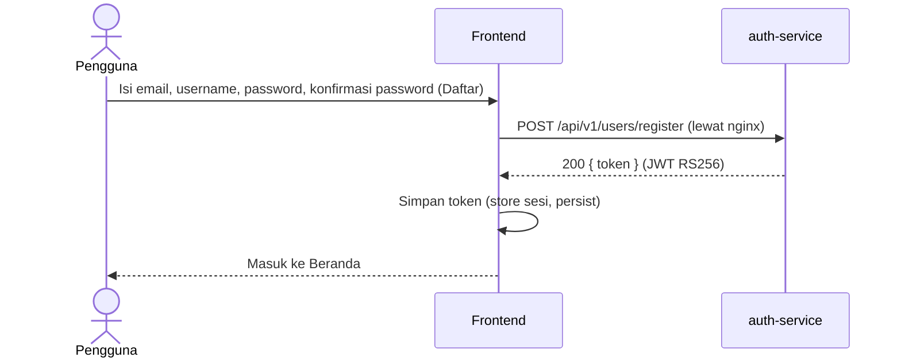
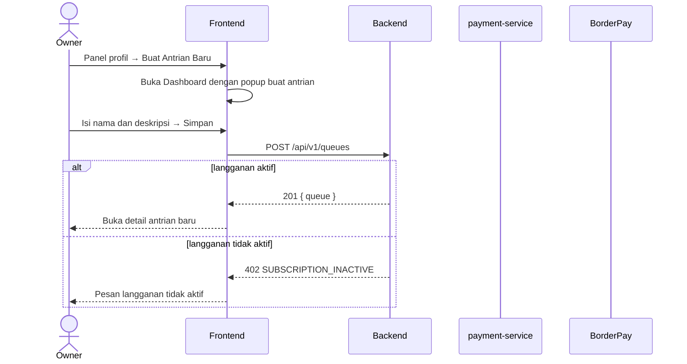
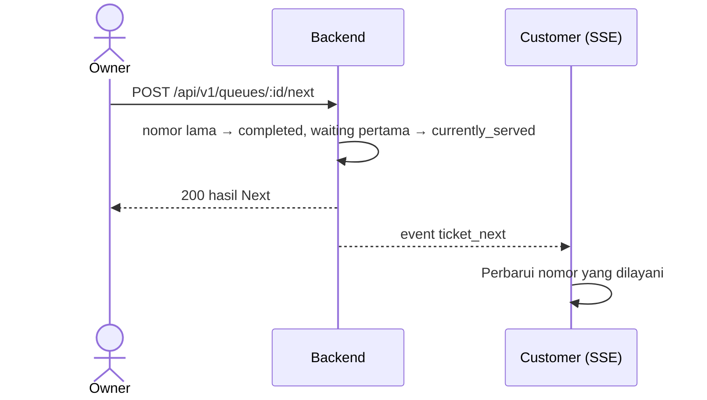
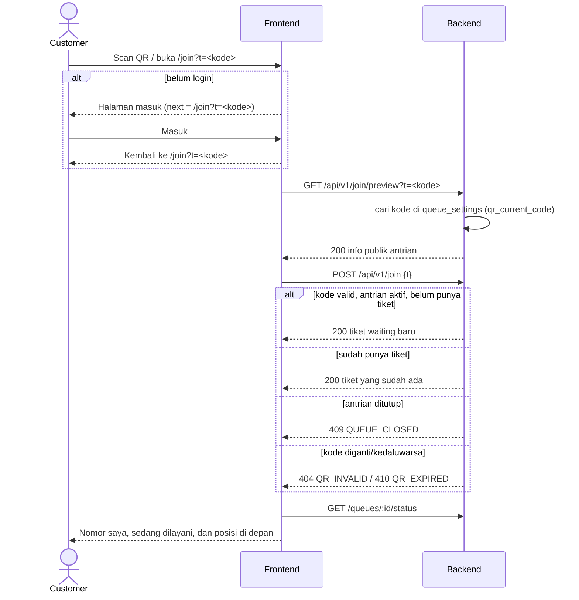
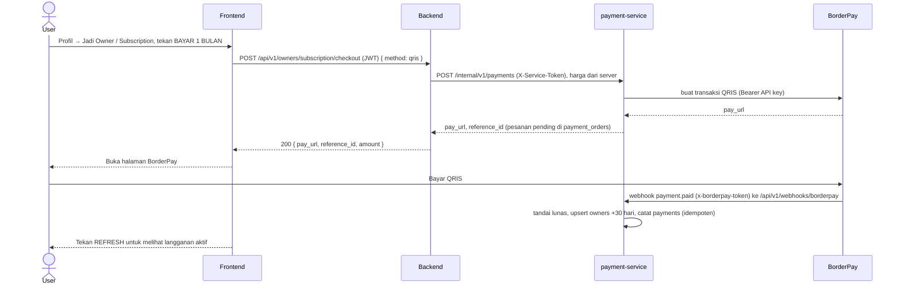

# Flow: Queue Management System

Alur pengguna dan alur sistem, dari sisi owner dan customer. Untuk detail request dan response lihat
[api-contract.md](api-contract.md). Untuk arsitektur lihat [DESIGN.md](DESIGN.md).

## 1. Akun dan sesi

- **Daftar**: email, username, password (minimal 8 karakter), dan konfirmasi password wajib diisi. Email atau username yang sudah dipakai ditolak (409). Bila konfirmasi berbeda dari password, pesan "Password tidak sama" tampil inline di bawah field konfirmasi (bukan toast), dan baru muncul setelah field itu kehilangan fokus atau tombol Daftar ditekan; pesan hilang saat isinya sudah sama. Login dan pendaftaran dilayani `auth-service` (nginx meneruskan `/api/v1/users/login`, `register`, dan seterusnya ke sana); backend hanya memverifikasi token dengan kunci publik.
- **Masuk**: halaman masuk ada di `/` (rute lama `/login` hanya mengarahkan ke sana). Bisa memakai email atau username. Kalau salah, pesan yang sama untuk kedua kasus.
- **Masuk atau daftar dengan Google**: tombol Google tampil hanya bila client ID Google dikonfigurasi. Email Google yang belum terdaftar membuat akun baru yang sudah terverifikasi. Bila email itu sudah terdaftar dengan password, user dibawa ke `/link-google` dan harus memasukkan password akunnya untuk menautkan (tidak ditautkan otomatis; link token hanya hidup 5 menit dan di memori, jadi membuka `/link-google` langsung atau me-refresh mengembalikan ke halaman masuk).
- **Sesi**: token disimpan di perangkat. Refresh halaman tidak membuat user keluar.
- **Sesi habis**: API membalas 401, sesi dihapus, dan user diarahkan ke halaman masuk. Setelah masuk lagi, user dibawa kembali ke halaman yang tadi dibuka (`next`).
- **Keluar**: lewat panel profil (menu "Keluar").
- **Profil**: ubah username, foto profil (privat, hanya terlihat oleh pemiliknya; tombol "Unggah Foto" atau "Ganti Foto" dan "Hapus Foto" dengan konfirmasi), dan sakelar "Notifikasi email" (`/profile`, `/profile/edit`). Bila foto sudah ada, mengetuk foto profil membuka popup foto yang diperbesar; popup ditutup dengan tombol X kecil di pojok foto, dengan mengetuk di luar kartu, atau tombol back perangkat. Tanpa foto (hanya ikon) tidak ada popup.
- **Lupa atau ganti password**: halaman `forgot-password` meminta tautan lewat email (jawaban selalu netral, tautan berlaku 30 menit dan sekali pakai); tautan membuka `/reset-password`, yang memakai aturan konfirmasi password yang sama dengan Daftar (pesan inline "Password tidak sama"). Setelah password diganti, sesi lain dicabut (401 berikutnya, lalu keluar otomatis). Tombol "Minta Ganti Password" di profil mengirim tautan yang sama. Rute ini hanya ada bila `mail-service` dipasang.
- **Verifikasi email**: bila `EMAIL_VERIFICATION_REQUIRED` menyala (bawaan: ikut adanya mail-service), registrasi mengirim tautan verifikasi (`email-verify`, berlaku 24 jam, sekali pakai) ke `/verify-email?token=`. Halaman itu publik (tautan sering dibuka di perangkat yang belum masuk) dan menampilkan hasilnya: "Email Terverifikasi", "Tautan Tidak Berlaku", atau "Verifikasi Gagal" (tombol "Coba Lagi"). Setelah verifikasi berhasil, auth-service juga mengirim email konfirmasi `email-verified` (best effort: gagal kirim tidak mengubah hasil verifikasi). Selama belum terverifikasi, login tetap bisa, tetapi **membuat antrian** dan **join dengan nomor baru** ditolak 403 `EMAIL_NOT_VERIFIED` (pesan mengarahkan ke Profil). **Halaman Profil** menampilkan banner "Email belum diverifikasi" dengan tombol "Kirim Ulang Email Verifikasi" (`POST /users/me/verify-email/resend`, maks 3 per jam per akun); banner hilang setelah verifikasi. Di dev email masuk Mailpit; di prod ikut `MAIL_MODE` (`smtp` = inbox asli seperti Gmail, `mailpit` = ditangkap Mailpit, tidak terkirim; jalan keluarnya `make verify-user EMAIL=... STACK=prod`). Akun yang sudah ada saat fitur dipasang dan akun seed/demo dianggap sudah terverifikasi.

## 2. Owner: membuat antrian

Syarat: langganan owner aktif. Tanpa langganan, tombol buat antrian tidak bisa dipakai dan API membalas 402. User biasa menjadi owner lewat pembayaran QRIS pertama (bagian 8).

- Menu "Buat Antrian Baru" ada di panel profil owner. Dari halaman lain, menu itu membuka Dashboard lebih dulu, lalu popup terbuka.
- Antrian baru langsung berstatus `active` dan otomatis punya satu counter default.
- Owner bisa memilih awalan tiket (1 sampai 3 huruf atau angka, bawaan `A`) sehingga label tiket menjadi mis. `A2`.

## 3. Owner: menjalankan antrian (Dashboard)

Dashboard menampilkan antrian aktif pertama milik owner. Tiap perangkat bertindak untuk satu counter (tab per counter; satu akun bisa dipakai di beberapa perangkat).

1. Papan menampilkan nomor **sebelumnya**, **sedang dilayani**, dan **berikutnya**, serta daftar tiket yang menunggu.
2. Owner menekan **Next** (ada popup konfirmasi; tidak ada undo):
   - Backend memanggil tiket `waiting` pertama untuk counter itu dan menyelesaikan nomor yang sebelumnya dilayani di counter yang sama (`completed`).
   - Papan diperbarui: nomor yang baru dipanggil menjadi "sedang dilayani", dan yang sebelumnya menjadi "sebelumnya".
   - Customer di antrian itu menerima event `ticket_next` dan melihat nomornya berubah.
3. Kalau tidak ada tiket yang menunggu, Next membalas 409 `QUEUE_EMPTY` dan tidak ada yang berubah.
4. Setiap event `ticket_joined` atau `ticket_next` memicu pengambilan ulang daftar tiket. Setelah koneksi pulih, daftar juga diambil ulang.

## 4. Owner: detail antrian

Dibuka dari Dashboard (ketuk judul antrian) atau dari Daftar Antrian. Layout dua kolom di layar lebar.

| Bagian | Fungsi |
|---|---|
| QR antrian | QR digambar di frontend dari `join_url`, mode statis/dinamis, hitung mundur, salin tautan, ganti kode (statis) |
| Tautan join | Tautan `<origin>/join?t=<kode>` berasal dari backend (tombol salin di kartu QR). Kode 6 karakter juga ditampilkan di kartu QR untuk diketik manual |
| SKIP / NEXT | Keduanya berfungsi (dengan popup konfirmasi). SKIP melewati nomor yang dilayani lalu memanggil berikutnya; nomor yang dilewati tampil "dilewati" atau kembali Menunggu sesuai pengaturan "Saat nomor dilewati" (dihapus, mundur ke belakang, mundur N nomor; ada batas pengembalian per nomor) |
| Append Note | Popup catatan untuk nomor yang sedang dilayani. Dibuka dengan catatan yang sudah ada (GET), simpan membuat atau menimpa (PUT). Catatan tampil di daftar tiket dan riwayat owner, tidak pernah ke customer. Tombol nonaktif bila belum ada nomor yang dilayani |
| Tampilan customer | Nomor yang sedang dilayani (tanpa posisi sebelum/sesudah) |
| Daftar tiket | Ketuk kartu tampilan customer untuk membuka semua tiket antrian, lengkap dengan catatan |
| Layar live | Rute `/queues/:id/live`: papan layar penuh untuk owner |
| Nama dan deskripsi | Ubah lalu SIMPAN (PUT) |
| Counter | "+ Tambah counter" (maks 10), ganti nama, hapus (nomor yang sedang dilayani kembali ke depan antrian, pemiliknya dapat push) |
| Sisip nomor | Sisipkan akun terdaftar (email atau username) di posisi tertentu (`POST /insert`) |
| Hapus nomor | Owner menghapus nomor yang menunggu atau sedang dilayani setelah popup konfirmasi (`POST /tickets/:id/remove`, status `deleted`, tanpa fallback) |
| Layar Publik | Kartu pengaturan: aktifkan layar, jumlah nomor berikutnya dan dilewati (0-10), salin atau buka tautan, ganti tautan, matikan (bagian 6b) |
| Tutup antrian | Konfirmasi dulu, lalu POST `/close` |

Tutup antrian:
1. Owner menekan TUTUP ANTRIAN, lalu mengonfirmasi di popup.
2. Antrian berstatus `closed`. Customer yang belum bergabung tidak bisa join lagi (409 `QUEUE_CLOSED`).
3. Customer yang sudah punya tiket melihat status "antrian ditutup" di halaman mereka. Tiket mereka pindah ke Riwayat.
4. Event `queue_closed` dikirim ke semua yang sedang tersambung.
5. Owner menerima email `queue-closed` (bagian 6c) bila sakelar "Notifikasi email"-nya menyala; tautannya membuka `/riwayat`.
6. Antrian muncul di Riwayat owner (`/history`): daftar antrian yang sudah ditutup (berhalaman), detail tiap nomor dengan hasil dan catatan, dan ekspor CSV atau Excel (`/history/queues/:id/export`).

## 5. Customer: bergabung ke antrian

- Customer harus login sebelum bisa bergabung. Setelah login, halaman join dibuka lagi dengan kode utuh.
- Scan atau tekan Gabung berulang kali tidak membuat tiket kedua. Layar hanya menampilkan nomor yang sudah ada.
- Join hanya lewat kode join; `POST /queues/:id/join` sudah dihapus. Kode statis yang sudah diganti ditolak.
- **Kode join**: 6 karakter huruf dan angka tanpa 0, O, 1, I, L (sekitar satu miliar kombinasi), dibuat backend dan unik di seluruh antrian. Pengunjung bisa memindai QR atau mengetik kodenya di popup "Masuk Ke Antrian" (huruf kecil diterima). Kode disimpan di `queue_settings.qr_current_code`; hanya kode aktif yang berlaku.
- **Kode statis** berlaku sampai owner menekan "Ganti kode". **Kode dinamis** berlaku 120 detik dan diganti otomatis setelah ada yang berhasil join (kode lama langsung tidak berlaku), atau saat kedaluwarsa dan owner membuka QR. Join yang gagal (misalnya sudah pernah join) tidak mengganti kode.
- Tidak ada pembatasan percobaan khusus untuk kode; batas per IP tetap dari nginx (`join_zone`).
- Gabung di PC bisa lewat tombol "Masuk Ke Antrian" di Beranda (scan placeholder atau tempel tautan join di popup). Di HP, lewat tombol QR di tengah navbar.
- Kalau email belum terverifikasi dan verifikasi menyala, join dibalas 403 `EMAIL_NOT_VERIFIED` (lihat bagian 1).
- Setelah bergabung, customer menerima email "masuk antrian" (bagian 6c) bila sakelar email menyala.

## 6. Customer: memantau antrian

Sumber data: `GET /queues/:id/status` saat dibuka, lalu SSE untuk pembaruan.

- **Beranda**: kartu untuk setiap tiket yang masih relevan (menunggu di antrian aktif, atau nomornya sedang dilayani).
  Kalau tidak ada, muncul kartu "Anda tidak sedang mengantri".
- **Antrian Saya**: daftar tiket yang sama dengan kriteria Beranda.
- **Riwayat**: satu baris per tiket (terbaru dulu, berhalaman, `GET /users/me/history`) dengan hasilnya: selesai, dilewati, dibatalkan, dihapus owner, atau antrian ditutup. Catatan owner tidak ikut.
- **Batalkan nomor**: di layar tiket customer menekan tombol batalkan lalu konfirmasi (`POST /queues/:id/cancel`). Tiket berstatus `cancelled`, tersimpan di riwayat, dan antrian maju seperti biasa; menekan dua kali tidak menimbulkan galat.
- **Dihapus owner**: customer melihat "Dihapus" secara real-time.

**Notifikasi giliran (Web Push).** Saat customer bergabung lewat scanner, browser otomatis meminta izin notifikasi dan berlangganan; bila izin ditolak atau tidak didukung tidak terjadi apa-apa, dan tombol "Aktifkan notifikasi" di layar tiket tetap tersedia. Saat nomornya dipanggil ia menerima "Giliran Anda"; customer di urutan waiting terdepan menerima "Tinggal 1 nomor lagi". Di detail antrian, setelah Next tombol Skip diganti "Panggil ulang" (mati 3 detik); setelah diklik, tombol kembali menjadi Skip yang mati 3 detik. Panggil ulang sekali per nomor; push hanya ke nomor yang sedang dilayani. Customer yang nomornya dilewati juga menerima push (dilewati permanen, atau dikembalikan ke antrian).

Event SSE yang diterima customer:

| Event | Yang terjadi di layar |
|---|---|
| `ticket_joined` | Posisi di depan diperbarui |
| `ticket_skipped` | Nomor yang dilayani dilewati; status tiket menjadi Dilewati, atau Menunggu bila dikembalikan |
| `ticket_cancelled` | Tiket dibatalkan; posisi di depan diperbarui |
| `ticket_removed` | Nomor dihapus owner; status tiket menjadi Dihapus |
| `counter_updated` | Counter dibuat, diganti nama, atau dihapus |
| `ticket_next` | Nomor yang sedang dilayani dan posisi di depan diperbarui |
| `queue_updated` | Nama antrian diperbarui |
| `queue_closed` | Pesan "antrian ditutup", tiket pindah ke Riwayat |

Kalau koneksi terputus, klien mencoba menyambung lagi dengan jeda yang makin lama (1 detik sampai 30 detik),
lalu mengambil ulang status. Klien juga resinkron tiap 45 detik, dan tiap 3 detik bila proxy menahan stream.

Push "requeued": saat nomor kembali ke `waiting` (fallback Skip atau counter dihapus), pemiliknya menerima push dengan posisi barunya.

## 6b. Layar publik (tanpa login)

1. Owner mengaktifkan layar di detail antrian ("Layar Publik"), mengatur jumlah nomor berikutnya dan dilewati, lalu membuka tautan `/display/<token>` di monitor ruang tunggu.
2. Layar memuat snapshot (`GET /api/v1/display/:token`) lalu mendengarkan SSE di room tersendiri (`/display/:token/event`) yang hanya membawa sinyal `display_changed`; tiap sinyal memicu ambil ulang snapshot.
3. Satu kartu per counter, nomor berikutnya, dan dilewati. Hanya nomor, tanpa nama atau catatan.
4. Counter ditambah, diganti nama, atau dihapus: kartu berubah tanpa reload. Antrian ditutup: "Antrian ditutup". Koneksi putus: status "Menyambung ulang...".
5. "Ganti tautan" atau "Matikan" membuat token lama langsung 404.

## 6c. Email notifikasi

Customer menerima email `joined` saat bergabung, `cancelled` saat membatalkan, `removed` saat nomornya dihapus owner, dan `completed` saat selesai dilayani (termasuk saat antrian ditutup). Owner menerima email `queue-closed` saat ia menutup antrian (tautan ke `/riwayat`). Alurnya: trigger database (`tickets_email_outbox_trg` untuk tiket, `queues_email_outbox_trg` untuk penutupan antrian) menulis `notification_outbox` dalam transaksi yang sama dengan perubahan, lalu worker di `mail-service` mengirim lewat SMTP dan mencoba ulang bila gagal. Scan ulang tidak membuat email kedua dan satu antrian hanya menghasilkan satu email `queue-closed`. Pengguna bisa mematikannya di Profil (sakelar "Notifikasi email" berlaku untuk customer dan owner); catatan owner tidak pernah ada di email. Email akun tidak lewat outbox: `email-verify`, `password-reset`, dan `email-verified` dikirim langsung oleh `auth-service` ke mail-service. Dev: email ditangkap Mailpit.

## 7. Tema tampilan

- Tombol matahari/bulan sabit di panel profil mengganti mode terang dan gelap.
- Pilihan disimpan di perangkat dan dipulihkan saat aplikasi dibuka lagi.
- Warna papan antrian dan header tidak berubah, karena memang gelap di kedua mode.

## 8. Langganan dan menjadi owner

Pembayaran langganan lewat QRIS BorderPay. Backend membuat pesanan lewat `payment-service`, lalu webhook BorderPay yang memperpanjang langganan 30 hari. Webhook adalah sumber kebenaran; pengalihan browser hanya untuk UX.

- Calon owner memilih langganan satu bulan di layar Subscription lalu membayar lewat QRIS. Pembayaran pertama dari user biasa sekaligus menjadikannya owner. Owner yang sudah ada memperpanjang masa berlakunya dengan cara yang sama.
- Setelah membayar, customer kembali ke aplikasi. Status langganan diperbarui oleh webhook; tekan REFRESH bila belum berubah.
- Masa berlaku dihitung dari tanggal berakhir bila masih aktif, atau dari sekarang bila sudah lewat. Satu baris `payments` dicatat per pembayaran yang lunas.
- Webhook kembar tidak menerapkan pembayaran dua kali. Nominal yang tidak sama dengan pesanan ditolak (409) dan tidak diterapkan.
- Pembuatan antrian memeriksa `subscription_expires_at` (402 `SUBSCRIPTION_INACTIVE` bila lewat). Backend hanya membaca status langganan; pembayaran tidak mengubah antrian.
- Bila payment-service mati, checkout membalas 503 `PAYMENT_UNAVAILABLE`, sedangkan login, antrian, dan tiket tetap berjalan.

## 9. Yang belum punya alur

Fitur di bawah ini belum dibangun, sehingga alurnya belum bisa dijalankan: ganti alamat email, QR join di layar publik, pembayaran sungguhan dan plan langganan selain tambah 30 hari, serta observability dan uji beban.