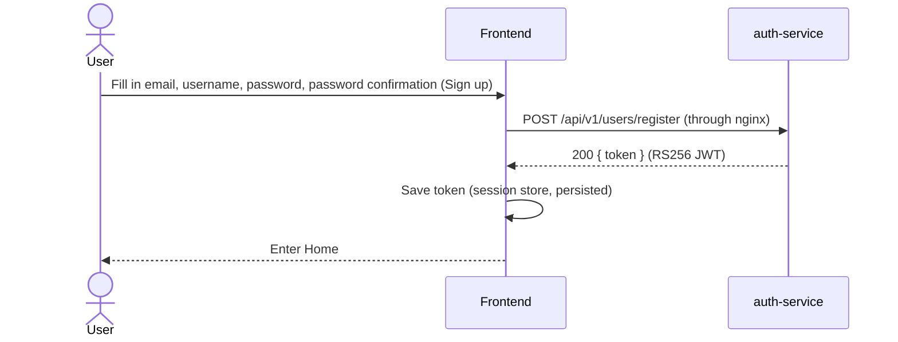
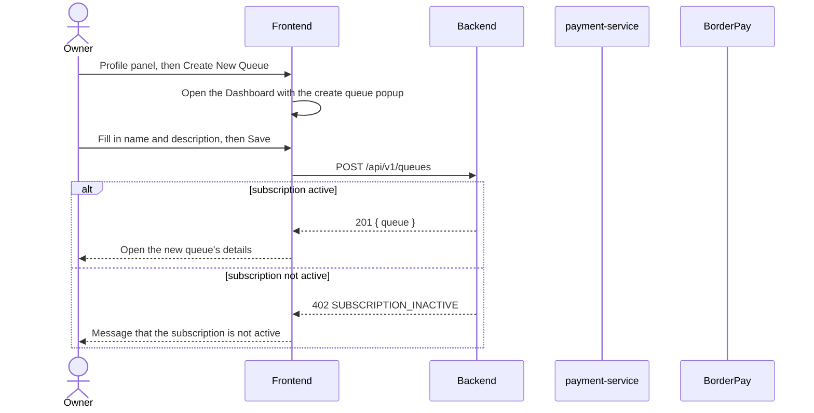
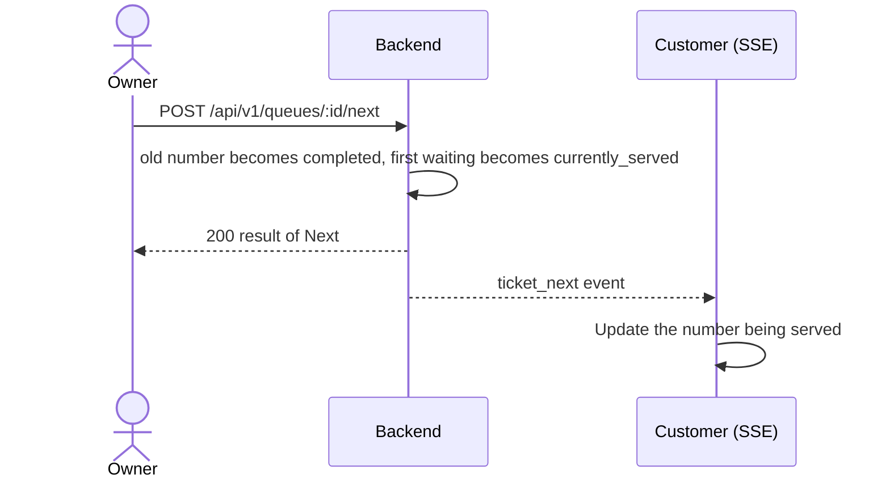
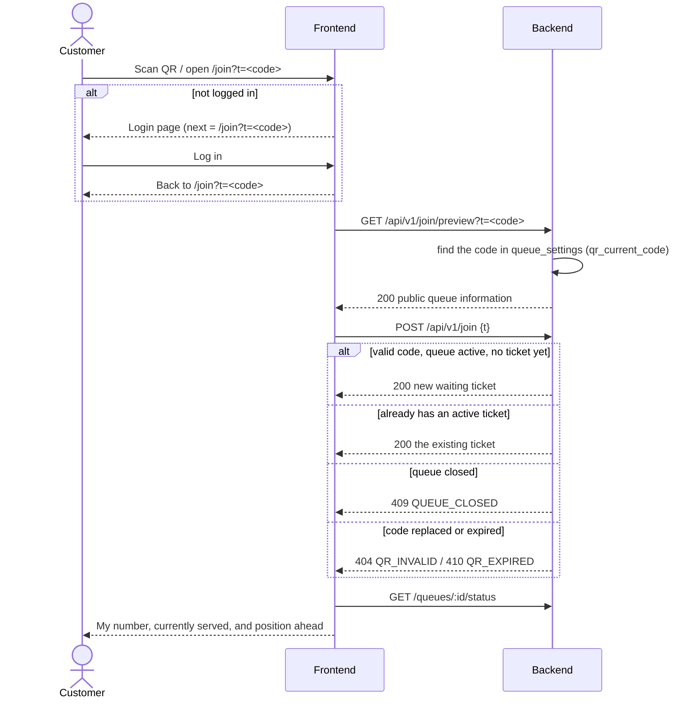
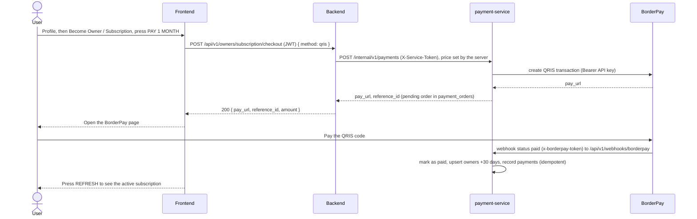

# Flow: Queue Management System

User flows and system flows, from the owner and customer side. For request and response details see
[api-contract.md](api-contract.md). For architecture see [DESIGN.md](DESIGN.md).

## 1. Account and session

- **Sign up**: email, username, password (at least 8 characters), and password confirmation are required. An email or username that is already in use is rejected (409). If the confirmation differs from the password, the message "Passwords do not match" appears inline under the confirmation field (not as a toast), and it only appears after that field loses focus or the Sign up button is pressed; the message disappears when the values match. Login and registration are served by `auth-service` (nginx forwards `/api/v1/users/login`, `register`, and so on there); the backend only verifies the token with the public key.
- **Log in**: the login page is at `/login`; `/` is only an entry point that sends guests to `/login` (and logged-in users to `next` or `/dashboard`). You can use an email or a username. If the credentials are wrong, the same message is shown for both cases.
- **Log in or sign up with Google**: the Google button appears only when a Google client ID is configured. A Google email that is not registered yet creates a new account that is already verified. If that email is already registered with a password, the user is taken to `/link-google` and must enter the password of that account to link it (it is never linked automatically; the link token lives only 5 minutes and in memory, so opening `/link-google` directly or refreshing it returns the user to the login page).
- **Session**: the token is stored on the device. Refreshing the page does not log the user out.
- **Session expired**: the API answers 401, the session is removed, and the user is sent to the login page. After logging in again, the user returns to the page they were on (`next`).
- **Log out**: from the profile panel (the "Log out" menu item).
- **Profile**: change the username, profile photo (private, visible only to its owner; "Upload Photo" or "Change Photo" and "Delete Photo" with confirmation), and the "Email notifications" switch (one page, `/profile`; the route `/profile/edit` has been removed). When a photo exists, tapping it opens an enlarged photo popup; the popup is closed with a small X button in the corner of the photo, by tapping outside the card, or with the device back button. Without a photo (icon only) there is no popup.
- **Forgot or change password**: the `forgot-password` page requests a link by email (the answer is always neutral, and the link is valid for 30 minutes and single use); the link opens `/reset-password`, which uses the same password confirmation rule as Sign up (inline "Passwords do not match" message). After the password is changed, other sessions are revoked (their next request gets 401, and they log out automatically). The "Request Password Change" button on the profile sends the same link. This route only exists when `mail-service` is configured.
- **Email verification**: when `EMAIL_VERIFICATION_REQUIRED` is on (in auth-service it follows whether mail-service is configured; in the backend it is on by default), registration sends a verification link (`email-verify`, valid 24 hours, single use) to `/verify-email?token=`. That page is public (the link is often opened on a device that is not logged in) and shows the result: "Email Verified", "Link No Longer Valid", or "Verification Failed" (with a "Try Again" button). After a successful verification, auth-service also sends a `email-verified` confirmation email (best effort: a send failure does not change the verification result). While the account is not verified, login still works, but **creating a queue** and **joining with a new number** are rejected with 403 `EMAIL_NOT_VERIFIED` (the message points to the Profile). **The Profile page** shows an "Email not verified" banner with a "Resend Verification Email" button (`POST /users/me/verify-email/resend`, at most 3 per hour per account); the banner disappears after verification. In development the email goes to Mailpit; in production it follows `MAIL_MODE` (the default `mailpit` when empty = captured by Mailpit and not delivered to anyone; `smtp` = a real inbox such as Gmail; the way out is `make verify-user EMAIL=... STACK=prod`). Accounts that already existed when the feature was added, and seed and demo accounts, are treated as verified.

## 2. Owner: creating a queue

Requirement: an active owner subscription. Without a subscription, the create queue button cannot be used and the API answers 402. A regular user becomes an owner with their first QRIS payment (section 8).

- The "Create New Queue" menu item is in the owner's profile panel. From other pages, the menu first opens the Dashboard, and then the popup appears.
- A new queue is immediately `active` and automatically gets one default counter.
- The owner can choose a ticket prefix (1 to 3 letters or digits, default `A`), so that the ticket label becomes, for example, `A2`.

## 3. Owner: running a queue (Dashboard)

The Dashboard shows the owner's first active queue. Each device acts for one counter (a tab per counter; one account can be used on several devices).

1. The board shows the **previous**, **currently served**, and **next** numbers, plus the list of waiting tickets.
2. The owner presses **Next** (a confirmation popup appears; there is no undo):
   - The backend calls the first `waiting` ticket for that counter and completes the number previously served at the same counter (`completed`).
   - The board is updated: the newly called number becomes "currently served", and the previous one becomes "previous".
   - Customers in that queue receive a `ticket_next` event and see their number change.
3. If no ticket is waiting, Next answers 409 `QUEUE_EMPTY` and nothing changes.
4. Every `ticket_joined` or `ticket_next` event triggers a refetch of the ticket list. After the connection recovers, the list is also refetched.

## 4. Owner: queue details

Opened from the Dashboard (tap the queue title) or from the Queue List. Two-column layout on wide screens.

| Section | Purpose |
|---|---|
| Queue QR | The QR code is drawn in the frontend from `join_url`; static or dynamic mode, countdown, copy link, replace the code (static) |
| Join link | The link `<origin>/join?t=<code>` comes from the backend (copy button on the QR card). The 6-character code is also shown on the QR card for typing manually |
| SKIP / NEXT | Both work (with a confirmation popup). SKIP skips the number being served and then calls the next one; the skipped number is shown as "skipped" or returned to Waiting according to the "When a number is skipped" setting (removed, returned to the back, returned N numbers back; there is a return limit per number) |
| Append Note | A note popup for the number being served. It opens with the existing note (GET), and saving creates or overwrites it (PUT). The note appears in the owner's ticket list and history, and never to the customer. The button is disabled when no number is being served |
| Customer view | The number being served (without the positions before and after) |
| Ticket list | Tap a card on the customer view to open all tickets of the queue, including notes |
| Live screen | The route `/queues/:id/live`: a full-screen board for the owner |
| Name and description | Change, then SAVE (PUT) |
| Counters | "+ Add counter" (max 10), rename, delete (the number being served returns to the front of the queue, and its owner gets a push) |
| Insert number | Insert a registered account (by email or username) at a specific position (`POST /insert`) |
| Remove number | The owner removes a waiting or served number after a confirmation popup (`POST /tickets/:id/remove`, status `deleted`, no fallback) |
| Public Display | Settings card: turn the display on, set the number of upcoming and skipped numbers (0 to 10), copy or open the link, replace the link, turn it off (section 6b) |
| Close queue | Confirm first, then POST `/close` |

Closing a queue:
1. The owner presses CLOSE QUEUE, then confirms in the popup.
2. The queue becomes `closed`. Customers who have not joined yet cannot join anymore (409 `QUEUE_CLOSED`).
3. Customers who already have a ticket see a "queue closed" status on their page. Their tickets move to History.
4. A `queue_closed` event is sent to everyone who is connected.
5. The owner receives a `queue-closed` email (section 6c) if their "Email notifications" switch is on; its link opens `/riwayat`.
6. The queue appears in the owner's History (`/history`): the list of closed queues (paged), the details of each number with its outcome and note, and CSV or Excel export (`/history/queues/:id/export`).

## 5. Customer: joining a queue

- The customer must log in before joining. After logging in, the join page opens again with the full code.
- Scanning or pressing Join again and again while the ticket is still active (`waiting` or `currently_served`) does not create a second ticket: join answers 200 with the existing ticket. After that ticket is completed, cancelled, skipped, or deleted, joining creates a new ticket with a new number.
- Joining is only possible through a join code; `POST /queues/:id/join` has been removed. A replaced static code is rejected.
- **Join code**: 6 letters and digits without 0, O, 1, I, or L (about one billion combinations), generated by the backend and unique across all queues. Visitors can scan the QR or type the code in the "Join the Queue" popup (lowercase is accepted). The code is stored in `queue_settings.qr_current_code`; only the active code is valid.
- **Static codes** are valid until the owner presses "Replace code". **Dynamic codes** are valid for 120 seconds and are replaced automatically after someone joins successfully (the old code stops working immediately), or when they expire and the owner opens the QR. A join that fails (for example, the customer has already joined) does not replace the code.
- There is no special attempt limit for codes; the per-IP limit from nginx (`join_zone`) still applies.
- On a PC, joining works through the "Join the Queue" button on the Home page (scan a placeholder or paste the join link in the popup). On a phone, use the QR button in the middle of the navbar.
- If the email is not verified and verification is on, joining is answered with 403 `EMAIL_NOT_VERIFIED` (see section 1).
- After joining, the customer receives a "joined the queue" email (section 6c) if the email switch is on.

## 6. Customer: following the queue

Data source: `GET /queues/:id/status` when opened, then SSE for updates.

- **Home**: a card for every ticket that is still relevant (waiting in an active queue, or its number is being served).
  If there are none, a "You are not in a queue" card is shown.
- **My Queues**: the same ticket list as Home, with the same criteria.
- **History**: one row per ticket (newest first, paged, `GET /users/me/history`) with its outcome: completed, skipped, cancelled, removed by the owner, or queue closed. The owner's notes are not included.
- **Cancel a number**: on the customer's ticket screen, press cancel and then confirm (`POST /queues/:id/cancel`). The ticket becomes `cancelled`, is kept in history, and the queue moves on as usual; pressing twice does not cause an error.
- **Removed by the owner**: the customer sees "Removed" in real time.

**Turn notifications (Web Push in the browser, FCM in the Android app).** In the browser, when a customer joins through the scanner, the browser asks for notification permission and subscribes automatically; if permission is denied or not supported, nothing happens, and the "Enable notifications" button on the ticket screen stays available. In the Android app, the customer presses "Enable notifications" on the ticket screen and allows the Android dialog; notifications appear even when the app is closed, and tapping one opens the ticket screen (`/ticket/<queueId>`). If permission was denied, the button shows how to enable it in Settings. In Expo Go and on iOS the button is not shown. When their number is called, the customer receives "Your turn"; the customer first in the waiting order receives "1 number left". On the queue details, after Next, the Skip button is replaced by "Recall" (disabled for 3 seconds); after it is pressed, the button returns to Skip, disabled for 3 seconds. Recall is allowed once per number; the push goes only to the number being served. A customer whose number is skipped also receives a push (skipped permanently, or returned to the queue).

SSE events received by the customer:

| Event | What happens on the screen |
|---|---|
| `ticket_joined` | Position ahead is updated |
| `ticket_skipped` | The number being served was skipped; the ticket status becomes Skipped, or Waiting if it was returned |
| `ticket_cancelled` | The ticket was cancelled; position ahead is updated |
| `ticket_removed` | The number was removed by the owner; the ticket status becomes Removed |
| `counter_updated` | A counter was created, renamed, or deleted |
| `ticket_next` | The number being served and the position ahead are updated |
| `queue_updated` | The queue name is updated |
| `queue_closed` | A "queue closed" message, and the ticket moves to History |

If the connection drops, the client tries to reconnect with increasing delays (from 1 second up to 30 seconds), and then fetches the status again. The client also resyncs every 45 seconds, and every 3 seconds when a proxy holds back the stream.

"Requeued" push: when a number returns to `waiting` (a Skip fallback or a deleted counter), its owner receives a push with the new position.

## 6b. Public display (no login)

1. The owner turns on the display in the queue details ("Public Display"), sets the number of upcoming and skipped numbers, then opens the link `/display/<token>` on a monitor in the waiting area.
2. The screen loads a snapshot (`GET /api/v1/display/:token`) and listens to SSE in its own room (`/display/:token/event`), which only carries a `display_changed` signal; every signal triggers a snapshot refetch.
3. One card per counter, the next numbers, and the skipped numbers. Only numbers, without names or notes.
4. When a counter is added, renamed, or deleted, the cards change without a reload. When the queue is closed: "Queue closed". When the connection drops: the status "Reconnecting...".
5. "Replace link" or "Turn off" makes the old token return 404 immediately.

## 6c. Email notifications

Customers receive a `joined` email when they join, a `cancelled` email when they cancel, a `removed` email when the owner removes their number, and a `completed` email when they finish being served (including when the queue is closed). The owner receives a `queue-closed` email when they close a queue (the link goes to `/riwayat`). The flow: database triggers (`tickets_email_outbox_trg` for tickets, `queues_email_outbox_trg` for closing a queue) write `notification_outbox` in the same transaction as the change, and then the worker in `mail-service` sends through SMTP and retries on failure. Scanning again does not create a second email, and a queue produces only one `queue-closed` email. Users can turn them off in the Profile (the "Email notifications" switch applies to customers and owners); the owner's notes never appear in an email. Account emails do not go through the outbox: `email-verify`, `password-reset`, and `email-verified` are sent directly by `auth-service` to mail-service. In development, emails are captured by Mailpit.

## 7. Display theme

- The sun/crescent button in the profile panel switches between light and dark mode.
- The choice is stored on the device and restored when the app is opened again.
- The colors of the queue board and the header do not change, because they are dark in both modes.

## 8. Subscription and becoming an owner

Subscription payments go through QRIS BorderPay. The backend creates the order through `payment-service`, then the BorderPay webhook extends the subscription by 30 days. The webhook is the source of truth; the browser redirect is only for UX.

- A prospective owner chooses the one-month subscription on the Subscription screen and pays with QRIS. The first payment from a regular user also makes them an owner. An existing owner extends their period in the same way.
- After paying, the customer returns to the app. The subscription status is updated by the webhook; press REFRESH if it has not changed yet.
- The period is counted from the current expiry date if it is still active, or from now if it has already passed. One `payments` row is recorded for each confirmed payment.
- A duplicate webhook does not apply the payment twice. An amount that does not match the order is rejected (409) and not applied.
- Creating a queue checks `subscription_expires_at` (402 `SUBSCRIPTION_INACTIVE` if it has passed). The backend only reads the subscription status; a payment does not change any queue.
- If payment-service is down, checkout answers 503 `PAYMENT_UNAVAILABLE`, while login, queues, and tickets keep working.

## 9. Flows that do not exist yet

The features below are not built yet, so their flows cannot be run: changing the email address, the QR join on the public display, real payments and subscription plans other than a 30-day extension, and observability and load testing.